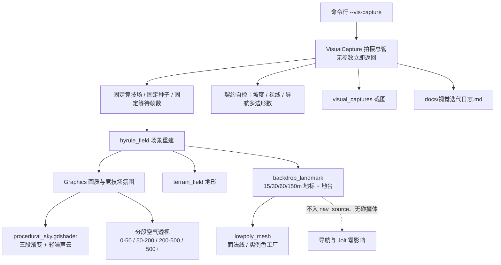

## 产品概述

对现有第三人称生存射击游戏 `godot-zelda` 做一次**按改进局 trash 的视觉升级**。所有表现继续保持**纯程序生成**，不引入任何外部美术资产包、贴图或手工模型。目标是让世界从"均匀发亮的块状 Demo"，变成有**天空明暗构图、分段空气透视、宏大历史尺度**的暗色低多边形雕塑风格。

## 核心需求

### Round 0：固定视觉测试设施（先决条件）

- 建立**固定 Visual Test Scene 与固定相机**，一键运行、自动截图、自动退出。
- 必须有**能同时看到天空、中景、远景剪影与巨型地标**的机位，否则本轮三项无法复核。
- 固定竞技场、固定种子、固定等待帧数、固定是否显示 HUD，保证每轮画面严格可比。
- 每轮自动输出**玩法契约自检**结果（坡度可走 / 掩体挡视线 / 导航烘焙）。

### Round 1 三项（严格按用户指定的施工顺序）

1. **程序分层天空（最高优先级）**

- 顶部深灰蓝 → 中层灰蓝 → 地平线略亮，天空比地面亮但整体是阴天厚云。
- 叠加**很轻的程序噪声云层**，不用真实体积云，不用任何贴图，纯数学噪声即可。
- 核心目标：**天空本身形成一张巨大的明暗构图**，而不是"云真实"。

2. **分段空气透视**

- 0–50m 几乎无雾；50–200m 开始降低对比；200–500m 明显蓝灰化；500m+ 只剩大型 silhouette。
- 目的是立刻产生**空间巨大感**。

3. **尺度大胆的巨型地标**

- 只由简单体块（Cube）组合，但尺度必须大胆：**15m 高墙 / 30m 柱子 / 60m 门框 / 150m 远景塔体**。
- 严禁"小房子 × 40"，要有由 마지막한 대지대한 지폐托住体量的背景地台。
- 远景部分必须是**不可交互的背景地景环**，对导航、碰撞、掩体视线零影响。

### 否决闸（贯穿所有轮的硬约束）

> 如果新增视觉细节**不能改善轮廓、构图、视觉层级或空间纵深**，就不要增加。

每轮必须在迭代日志里逐项打勾，答不上来就不做。

### 后续轮次（本轮不做，但已排定）

地形视觉网格大切面化 → 植被图形化 → 近景遗迹体量与主角可读性 → UI 冷色克制化。

## 不变的风格底线

- 色彩低饱和：灰蓝、暗灰绿、灰褐、冷石色；高饱和只留给火焰 / 交互物 / 目标物 / 关键 UI。
- 主角始终可从环境识别，**不用发光描边**。
- 不允许靠 Bloom / AO / Fog / 噪声 / 贴图细节去掩盖基础形体问题。

## 技术栈选型

沿用项目既有栈，不引入任何新依赖：Godot 4.7 Forward+ / d3d12 / Jolt，GDScript，`ArrayMesh` + `MultiMesh` + `StandardMaterial3D`，运行时烘焙 NavigationRegion3D，全部数值走 `data/game_config.json`。

三个关键取舍：

1. **本轮会引入项目里第一个着色器**（`res://shaders/procedural_sky.gdshader`，`shader_type sky`）。理由是用户明确要求"一个程序噪声生成的天空 Shader 就够"，且内置 `ProceduralSkyMaterial` 只能给"渐变 + 太阳盘"，做不出"顶部深灰蓝 → 中层灰蓝 → 地平线略亮"的三段明暗构图，也做不出可配 probability 的云层。除此之外**其余内容一律不用自定义着色器**。
2. **Flat shading 不靠着色器**：对每个面提交三个不共享顶点、写同一个面法线，即可得到硬边切面；再配合 `ARRAY_COLOR` / `MultiMesh` 实例色 + `vertex_color_use_as_albedo`，得到程序化色阶。零着色器风险。
3. **不走 `build_godot_scene`**：实测本机 **9080 未监听、无 Godot 编辑器进程**，该工具不可用。全部改动走「纯脚本 + 纯文本资源 + CLI」，**不修改任何现有 `.tscn`**，避免与 skill 的场景树约定冲突。

## 实施要点（据实测上下文）

- Godot 可执行文件在工作区**之外**：`D:\godot_project\Godot_v4.7.1-stable_win64.exe`。
- **当前有一个 `godot-zelda` 进程在跑（PID 27168，`build/windows/godot-zelda.exe`）**，每次跑图前必须先结束它，否则旧实例干扰。
- `res://` 在源码运行下可写，导出版只读 → 截图输出默认 `res://visual_captures`，写失败自动回 `user://visual_captures`（实测存在 `C:\Users\ZXG\AppData\Roaming\Godot\app_userdata\godot-zelda`）。
- **必须在 `RenderingServer.frame_post_draw` 之后取画面缓冲**，否则截到空帧或上一帧。
- **必须先对照本机 4.7 实测确认 `Environment` 的属性名**（`fog_aerial_perspective` / `fog_depth_curve` / `fog_mode` / `fog_depth_begin` 等），目前全仓搜索结果为 0，说明一个都没启用。用一次性脚本打印 `get_property_list()` 验证；代码层统一走"属性存在才写"的保护，属性名不对只能降级，绝不能崩。
- **`graphics_director._apply_sky()` 现有 `not (sky_material is ProceduralSkyMaterial): return` 是一道隐性陷阱**：换自定义天空后四张竞技场的 per-arena 覆盖会**静默失效**，必须先扩展它，并保持本项目"没配 = 不动"的既有约定。
- **`navigation_region.gd` 只用 `SOURCE_GEOMETRY_GROUPS_WITH_CHILDREN` + 组 `nav_source` + `geometry_collision_mask=1`** → 新地标只要不加入该组，就对导航烘焙与 Jolt **天然零影响**。这是"背景地景环"成立的技术依据。
- 分屏模式要画两遍 → 本轮新增的绘制调用必须控制在 **2 个**：地标一个 MultiMesh，背景地台一个 ArrayMesh。

## 架构设计



职责严格单一：`visual_capture.gd` 只管拍摄与自检；`backdrop_landmark.gd` 只管背景地景与巨型地标；`lowpoly_mesh.gd` 只管"面 → 硬边网格"的几何工厂，为后续地形大切面化预留同一套接口。

## Round 1 三项的具体技术路径

### ① 程序分层天空

新增 `res://shaders/procedural_sky.gdshader`（项目首个着色器，只依赖 `EYEDIR` / `COLOR` / `TIME` 三个 sky 内置量，低风险）。

- 三段渐变：`h = normalize(EYEDIR).y`，用 `smoothstep` 串联 `horizon → mid → top` 三个停止点，得到"地平线略亮、中层灰蓝、顶部深灰蓝"。
- 轻噪声云：对 `EYEDIR` 做 dome 投影后取 **3 个八度的纯数学值噪声 fbm**，再乘一条"中天空厚、近地平线与近天顶薄"的垂直带，形成**大尺度明暗块**，而不是碎 Cloud 细节。
- 可选：用 `LIGHT0_DIRECTION` 加一层很软的向光侧辉光，取代原来硬太阳盘（阴天不需要圆盘）。
- 全部参数经 `graphics_director.gd` 注入 uniform；`data/game_config.json` 新增 `lighting.arenas.<id>.sky_layers` 与 `.cloud` 两段；**缺的键一律不写**，保持既有约定。
- 不改变 `radiance_size`，自定义 sky 仍会生成 radiance cubemap，`ambient_light_source = SKY` 继续可用。

### ② 分段空气透视

落到 `Environment` 的必右组合（属性名先实测确认）：

| 目标距离 | 手段 |
| --- | --- |
| 0–50m 几乎无雾 | 低 `fog_density`（约 0.0008–0.0015）+ 较高 `fog_depth_curve`（约 2.5–4），让密度曲线在近场几乎不起效，后期再陡起 |
| 50–200m 降对比 | 密度随距离累积，配合 `fog_light_energy` 压低，避免整体发白 |
| 200–500m 蓝灰化 | 启用 ** `fog_aerial_perspective`**（约 0.4–0.7），让雾取天空 radiance 的冷蓝色，而不是手填的固定色 |
| 500m+ 只剩剪影 | 提高 `fog_sky_affect`（约 0.6–0.9）+ 地景实体**自带按距离分级的实例色**（越远越亮、越冷、对比越低） |


这套是在建立空间纵深，理由：近场保持高对比所以轮廓清晰，远场被天空色吃掉后细节消失、只剩体块外形——这正是"巨型轮廓建立空间"的程序化等价实现，而不是给画面糊一层白。

### ③ 尺度大胆的巨型地标

`scripts/backdrop_landmark.gd` 用 **确定性种子**（沿用 `arena.gd` 的 `SEED_BASE + id.hash()` 约定）生成，总数**实体 ≤ 12 个**：

| 层级 | 距离 | 内容 |
| --- | --- | --- |
| 近场锚点 | 70–110m | 1–2 段 **15m 断裂高墙** + 1–2 根 **30m 方柱**，两端不接触处做不同高度制造断口 |
| 中场焦点 | 140–220m | 1 座 **60m 门框**（双立柱 + 单横梁），刻意放在主路延伸方向，成为灭点处的构图焦点 |
| 远场剪影 | 350–700m | 2–4 座 **150m 塔体 / 巨型山体**，只以大切面体块呈现 |
| 背景地台 | 60–900m | 一张低分辨率大切面地台盘，颜色逐级向天空色靠拢，托住所有体量、消除"浮空板"感 |


- 全部由**单位 Cube 经 `MultiMesh` 变换**（位置 / 旋转 / 非统一缩放）+ **逐实例颜色**构成 → 一个 MultiMesh 绘制调用；地台单独一个 ArrayMesh。**本轮共增加 2 个绘制调用**。
- 材质：`StandardMaterial3D`，`vertex_color_use_as_albedo = true`、`roughness ≈ 0.95`、`metallic = 0`、面法线硬边；`cast_shadow = OFF`（远景超出 `directional_shadow_max_distance`，留着只浪费）。
- **无 `CollisionShape3D`、不加入 `nav_source` 组** → 对 Jolt 与导航烘焙零影响（依据见上文实测结论）。
- 明确不做：小房子、栅栏、重复小道具、任何数量为纲罗列的东西。

## 目录结构

```
d:/godot_project/godot-zelda/
├── project.godot                  # [MODIFY] autoload 段末尾新增 VisualCapture（放在 Graphics 之后）；主场景不变
├── data/game_config.json          # [MODIFY] 新增 visual（拍摄参数）、landscape（地标参数）两段；
│                                  #          graphics.procedural_sky 开关；lighting.arenas.<id> 增加
│                                  #          sky_layers / cloud / fog_extra 三组键（缺项=不动）
├── shaders/
│   └── procedural_sky.gdshader    # [NEW] 项目首个着色器。shader_type sky：三段渐变（顶深灰蓝→中灰蓝→
│                                  #       地平线略亮）+ 3 八度纯数学值噪声 fbm 的轻云层；不采样任何贴图
├── scripts/
│   ├── visual_capture.gd          # [NEW] 拍摄总管。读 OS.get_cmdline_user_args()，无 --vis-capture 立即返回；
│   │                              #       有则固定竞技场/等待帧数/逐个固定机位截图/跑契约自检/输出 PNG 后退出。
│   │                              #       必须 await RenderingServer.frame_post_draw 后再取画面缓冲
│   ├── lowpoly_mesh.gd            # [NEW] 几何工厂：按面提交 → 不共享顶点 → 面法线 → 硬边；提供实例色分级助手
│   ├── backdrop_landmark.gd       # [NEW] 场地外远景地台 + 15/30/60/150m 巨型地标。单 MultiMesh + 单 ArrayMesh，
│   │                              #       无碰撞体、不入 nav_source 组
│   └── graphics_director.gd       # [MODIFY] ① _apply_sky 支持 ShaderMaterial 并去掉仅 ProceduralSkyMaterial 的
│                                  #          隐性 return；② _apply_fog 增加分段空气透视键；③ 所有 Environment
│                                  #          写入先查属性存在，不存在只 warning 不崩
├── visual_captures/               # [NEW] 每轮截图输出目录
└── docs/视觉迭代日志.md           # [NEW] 每轮：差异三项 / 本轮改动 / 加法否决闸打勾 / 契约自检 / 下一轮判点
```

**不修改**：`scenes/hyrule_field.tscn`、`scenes/player.tscn`、`scripts/terrain_field.gd`、`scripts/arena.gd`、`scripts/navigation_region.gd`、`scripts/field_cover.gd`、`scripts/world_decor.gd` —— 全部留到后续轮次。

## 色彩秩序（本轮确定的 restraint palette）

| 类别 | 取值方向 |
| --- | --- |
| 天空顶 | 深灰蓝，明度最低但**不黑** |
| 天空中层 | 灰蓝 |
| 天空地平线 | 同色系略亮，形成亮带 |
| 远景地景（500m+） | 向地平线色收敛，几乎无对比 |
| 中景（50–200m） | 冷石色 / 暗灰绿，对比中等 |
| 近景（0–50m） | 暗灰绿 / 灰褐，高对比、轮廓清晰 |
| 高饱和保留 | 营火、神龛、交互物、目标物、关键 UI |


## 关键代码结构

**`.gdshader` uniform 契约**（由 `graphics_director.gd` 从配置注入）

```
uniform vec4 u_top_color      : source_color;  // 顶部 深灰蓝
uniform vec4 u_mid_color      : source_color;  // 中层 灰蓝
uniform vec4 u_horizon_color  : source_color;  // 地平线 略亮
uniform vec4 u_ground_color   : source_color;  // 地平线以下
uniform float u_mid_stop;                      // 中层停止点
uniform float u_horizon_width;                 // 地平线亮带宽度
uniform vec4  u_cloud_light   : source_color;
uniform vec4  u_cloud_shadow  : source_color;
uniform float u_cloud_amount;                  // 很轻：0.15~0.35
uniform float u_cloud_scale;
uniform float u_cloud_sharpness;
uniform float u_cloud_floor;                   // 云层出现的高度下限
```

**拍摄配置契约**（写在 `data/game_config.json` 的 `visual` 段，代码只读不写，缺项走兜底）

```
{
  "arena_id": "lakefront",
  "resolution": [1600, 900],
  "settle_frames": 150,
  "spawn_enemies": false,
  "show_hud": false,
  "output_dir": "res://visual_captures",
  "cameras": [
    { "name": "wide", "pos": [-52, 18, 62], "look_at": [0, 24, -140], "fov": 55 },
    { "name": "ots",  "pos": [0, 6.5, 22],  "look_at": [0, 2.0, -8],   "fov": 62 },
    { "name": "near", "pos": [8, 2.2, 12],  "look_at": [0, 3.0, -16],  "fov": 70 }
  ]
}
```

三个机位分别复核：**wide** 看天空构图 + 三段空气透视 + 巨型地标尺度；**ots** 看主角可识别性与近中景对比；**near** 看近景轮廓清晰度。

## 实施风险与护栏

- **属性名风险**：`fog_aerial_perspective` / `fog_depth_curve` / `fog_mode` 在 4.7 的确切可用性必须先实测；代码用 `has_env_property()` 保护，缺失则跳过并 `push_warning`。
- **天空换掉后的连锁**：`ambient_light_source = SKY` 依赖 radiance，需要确认自定义 sky 仍能正常生成 radiance cubemap；若偏暗再调 `ambient_light_energy`。
- **不要一次改完项目**：本轮**不碰**地形、植被、掩体、UI、玩家モデル；每轮结束都用同一套固定机位截图复核并写日志。
- **性能护栏**：新增绘制调用锁定为 2 个；`low` 画质档位下的最终帧率需在 Definitely 差点之前先跑一次对照截图确认没有明显退化。

## Agent Extensions

### Skill

- **godot-dev**
- 用途：本任务属于已有项目的修改，按其「场景 3 modify_game」执行；但实测 9080 未监听，因此挂靠传入行的 다른없이 **不用 `build_godot_scene`**，走纯脚本 + 纯文本资源路线，不修改任何 `.tscn`
- 预期结果：确认落在 modify_game；所有场景相关改动保持零 `.tscn` 编辑

- **godot-debug**
- 用途：仅在脚本编译失败、运行时报错、截图为空或全黑时激活，用 `get_debug_errors` / `get_script_errors` / `get_editor_output` 定位
- 预期结果：每轮跑图前确保无编译与运行错误，截图有效

### MCP

- **codebuddy-plugins-official/godot-mcp/godot-mcp**
- 用途：① 用 `get_editor_output` 取运行日志核对契约自检结果（导航多边形数、抛错）；② 仅在报错时用 `get_script_errors`；③ 若后续确需改 `.tscn` 且编辑器已启用插件，再用 `build_godot_scene`
- 预期结果：每轮输出无错误；导航多边形数大于 0；拉足够了对比所需的截图

### SubAgent

- **code-explorer**
- 用途：正式改 `graphics_director.gd` / 新增 `backdrop_landmark.gd` 前，确认 `_apply_sky` / `_apply_fog` / `apply_to_scene` 的所有调用点，以及 `nav_source` 组与 `MultiMesh` 的既有用法无遗漏
- 预期结果：给出受影响调用点清单，避免天空与雾改动波及 Ruas settled circular 상호작용