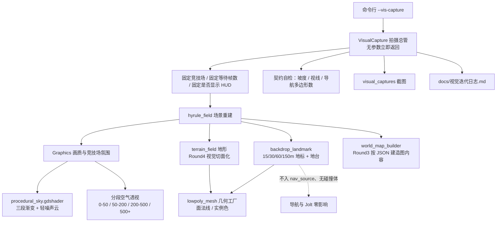

## 产品概述

对 Godot 4.7 第三人称生存射击游戏 `godot-zelda` 做一次**按轮次受控的视觉升级**。所有表现继续保持**纯程序生成**，不引入任何外部美术资产包、贴图或手工模型。目标是把世界从"均匀发亮的块状 Demo"，改造成具备**天空明暗构图、分段空气透视、宏大历史尺度**的统一暗色低多边形雕塑风格。

## 核心需求

### Round 0：固定视觉测试设施（先决条件）

- 建立**固定 Visual Test Scene 与固定相机**：一键运行、自动截图、自动退出。
- 必须有能**同时看到天空、中景、远景剪影与巨型地标**的机位，否则本轮三项无法复核。
- 固定竞技场、固定种子、固定等待帧数、固定是否显示 HUD，保证每轮画面严格可比。
- 每轮自动输出**玩法契约自检**结果（坡度可走 / 掩体挡视线 / 导航烘焙多边形数）。

### Round 1：大气层（最高优先级）

- **程序分层天空**：顶部深灰蓝 → 中层灰蓝 → 地平线略亮；天空比地面亮但整体是阴天厚云。叠加**很轻的程序噪声云层**，不用真实体积云、不用任何贴图。核心目标：**天空本身形成一张巨大的明暗构图**。
- **分段空气透视**：0–50m 几乎无雾；50–200m 开始降低对比；200–500m 明显蓝灰化；500m+ 只剩大型 silhouette，以此立刻产生**空间巨大感**。

### Round 2：尺度大胆的巨型地标

- 只由简单体块（Cube）组合，但尺度必须大胆：**15m 高墙 / 30m 柱子 / 60m 门框 / 150m 远景塔体**。
- 严禁"小房子 × 40"；必须有几百米量级的**背景地台**托住体量，消除"浮空板"感。
- 远景部分必须是**不可交互的背景地景环**，对导航、碰撞、掩体视线零影响。

### Round 3：地图与程序解耦（本次审计已查实）

- 已确认 `hyrule_field.tscn` 中 Roads / Lake / AncientRuins / EnemyCamp / 22 棵树、**玩家出生点**均为硬编码，新图会整组继承，是加地图包的真正阻塞点。
- 目标：新增一张地图 = **只改 `data/game_config.json`**，不需要改代码或场景。

### Round 4：地形地貌推翻重来

- 用户明确授权"整个地形地貌都可以推翻重来"，不为现有高度场的位置与观念所约束。
- 必须换成具有**明确大切面**的低多边形地形语言；山体岩石减少随机噪声、禁止碎石化与高频噪声。

## 否决闸（贯穿所有轮次的硬约束）

> 如果新增视觉细节**不能改善轮廓、构图、视觉层级或空间纵深，就不要增加。**

每轮必须在迭代日志里逐项打勾；答不上来就不做。

## 不变的风格底线

- 色彩低饱和：灰蓝、暗灰绿、灰褐、冷石色；高饱和只留给火焰 / 交互物 / 目标物 / 关键 UI。
- 主角始终可从环境识别，**不用发光描边**。
- 不允许靠 Bloom / AO / Fog / 噪声 / 贴图细节去掩盖基础形体问题。
- 优先级评分维度仍为：`silhouette → scale and proportion → composition → value structure → color → lighting → material → VFX → post processing`。

## 技术栈选型

沿用项目既有栈，**不引入任何新依赖**：Godot 4.7 Forward+ / d3d12 / Jolt，GDScript，`ArrayMesh` + `MultiMesh` + `StandardMaterial3D`，运行时烘焙 `NavigationRegion3D`，全部数值走 `data/game_config.json`。

四个关键取舍：

1. **Round 1 引入项目第一个着色器**（`res://shaders/procedural_sky.gdshader`，`shader_type sky`）。用户明确要求"一个程序噪声生成的天空 Shader 就够"；内置 `ProceduralSkyMaterial` 只能给"渐变 + 太阳盘"，做不出三段明暗构图与可配云层。**除此之外一律不用自定义着色器。**
2. **Flat shading 不靠着色器**：对每个三角形提交三个不共享顶点、写入同一个面法线即可得到硬边切面；配合 `ARRAY_COLOR` / MultiMesh 实例色 + `vertex_color_use_as_albedo` 得到程序化色阶。零着色器风险。
3. **不走 `build_godot_scene`**：实测 **9080 未监听、无 Godot 编辑器进程**，该工具不可用。全部改动走「纯脚本 + 纯文本资源 + CLI」。 Round 1~2 **不修改任何现有 .tscn**；Round 3 只做**退役**（`queue_free`）式的逻辑改造，同样不手改场景树。
4. **地形切面化采用"视觉降采样"，碰撞不动**：保留 `height_at()` 这个唯一真相入口与 1m 碰撞采样，只把**视觉网格**改成粗采样 + 不共享顶点 + 面法线。这样"坡度可走 / 掩体挡视线 / 导航烘焙"三条契约**天然不被破坏**，远好于 Terracing（台阶高度会撞上 `navigation.agent_max_climb = 0.5` 的硬约束）。

## 架构设计



职责严格单一：`visual_capture.gd` 只管拍摄与自检；`backdrop_landmark.gd` 只管背景地景与巨型地标；`lowpoly_mesh.gd` 是"面 → 硬边网格"的公共工厂（地形与地标共用）；`world_map_builder.gd` 只管按 JSON 建造每张图的地图内容。

## Round 0：拍摄闭环实现要点

- 新增 autoload `VisualCapture`（挂在 `Graphics` 之后），`_ready()` 里读 `OS.get_cmdline_user_args()`，**没有 `--vis-capture` 立即 return**，对正常游玩零影响。
- **必须在 `RenderingServer.frame_post_draw` 之后再 `get_viewport().get_texture().get_image()`**，否则截到空帧或上一帧。
- 输出目录先在 `res://visual_captures`（源码运行可写），写失败回退 `user://visual_captures`（实测存在 `C:\Users\ZXG\AppData\Roaming\Godot\app_userdata\godot-zelda`）。
- **每次跑图前必须先结束正在运行的 `godot-zelda` 进程**（当前 PID 27168，`build/windows/godot-zelda.exe`），否则旧实例干扰。
- 三个固定机位分工：`wide`（看天空构图 + 三段空气透视 + 地标尺度）、`ots`（看主角可识别性与近中景对比）、`near`（看近景轮廓清晰度）。
- 可参考命令：`D:\godot_project\Godot_v4.7.1-stable_win64.exe --path D:/godot_project/godot-zelda res://scenes/hyrule_field.tscn -- --vis-capture`

## Round 1：两项大气层的实现路径

### ① 程序分层天空

新增 `res://shaders/procedural_sky.gdshader`，只依赖 `EYEDIR` / `COLOR` / `TIME` 三个 sky 内置量：

- 三段渐变：`h = normalize(EYEDIR).y`，用两个 `smoothstep` 串联 `horizon → mid → top` 停止点，得到"地平线略亮、中层灰蓝、顶部深灰蓝"。
- 轻噪声云：对 `EYEDIR` 做 dome 投影后取 **3 个八度的纯数学 hash-value-noise fbm**（不含任何 `texture()` 采样），再乘一条"中天空厚、近地平线与近天顶薄"的垂直带，形成**大尺度明暗块**而非碎云细节。
- 抑制原有硬太阳盘；可选留一道很软的向光侧辉光。
- **必须扩展 `graphics_director._apply_sky()`**：现有 `not (sky_material is ProceduralSkyMaterial): return` 会让四张竞技场的 per-arena 天空覆盖**静默失效**。改为对 `ShaderMaterial` 逐个写 uniform，**并保持本项目"没配 = 不动"约定**（缺的键一律不写 uniform）。
- 不改 `radiance_size`，验证自定义 sky 仍能生成 radiance cubemap（`ambient_light_source = SKY` 依赖它）。

### ② 分段空气透视

| 目标距离 | 手段 |
| --- | --- |
| 0–50m 几乎无雾 | 低 `fog_density`（约 0.0008–0.0015）+ 较高 `fog_depth_curve`（约 2.5–4），让曲线近场几乎不起效、后期陡起 |
| 50–200m 降对比 | 密度随距离累积，配合压低 `fog_light_energy`，避免整体发白 |
| 200–500m 蓝灰化 | 启用 **`fog_aerial_perspective`**（约 0.4–0.7），让雾取自天空 radiance 的冷色而非手填固定色 |
| 500m+ 只剩剪影 | 提高 `fog_sky_affect`（约 0.6–0.9）+ 地景自带**按距离分级的实例色**（越远越亮、越冷、对比越低） |


**属性名必须先实测确认**：全仓搜索 `fog_aerial_perspective` / `fog_depth_curve` 结果均为 0，说明一个都没启用。动手前用一次性脚本打印 `Environment` 的 `get_property_list()` 核对 4.7 的确切属性名；代码层统一走 `_set_env_if_exists()` 保护，**属性不存在只 `push_warning` 降级，绝不崩溃**。

这套是在建立空间纵深而非糊画面：近场保持高对比所以轮廓清晰，远场被天空色吃掉后细节消失、只剩体块外形——正是"用巨型轮廓建立空间"的程序化等价实现。

## Round 2：巨型地标实现路径

`scripts/backdrop_landmark.gd`，确定性种子沿用 `arena.gd` 的 `SEED_BASE + id.hash()` 约定，**实体 ≤ 12 个**：

| 层级 | 距离 | 内容 |
| --- | --- | --- |
| 近场锚点 | 70–110m | 1–2 段 **15m 断裂高墙** + 1–2 根 **30m 方柱**，高度错开制造断口 |
| 中场焦点 | 140–220m | 1 座 **60m 门框**（双立柱 + 单横梁），刻意放在主路延伸方向成为灭点焦点 |
| 远场剪影 | 350–700m | 2–4 座 **150m 塔体 / 巨型山体**，只以大切面体块呈现 |
| 背景地台 | 60–900m | 一张低分辨率大切面地台盘，颜色逐级向天空色靠拢，托住所有体量 |


- 全部由**单位 Cube 经 MultiMesh 变换**（位置 / 旋转 / 非统一缩放）+ **逐实例颜色**构成 → 一个绘制调用；地台单独一个 ArrayMesh。**本轮新增绘制调用锁定为 2 个**（分屏会画两遍，必须守住预算）。
- 材质 `StandardMaterial3D`：`vertex_color_use_as_albedo = true`、`roughness ≈ 0.95`、`metallic = 0`；`cast_shadow = OFF`（远景已在 `directional_shadow_max_distance` 之外，留着只浪费）。
- **无 `CollisionShape3D`、不加入 `nav_source` 组** → 依据 `navigation_region.gd` 只用 `SOURCE_GEOMETRY_GROUPS_WITH_CHILDREN` + 组 `nav_source`，对 Jolt 与导航烘焙天然零影响。
- 明确不做：小房子、栅栏、重复小道具、任何靠数量罗列的东西。

## Round 3：解耦整改方案（本次审计结论）

对 `hyrule_field.tscn` 的四组静态节点与 22 棵树，采用"**数据定义 + 统一建造 + legacy 退役**"三件套：

1. `data/game_config.json` 的 `arenas.definitions.<id>` 增加 `map` 子段：`spawn_origin`、`water[]`（矩形水面+底床）、`roads[]`（起止点+宽度）、`ruins[]`（体块列表）、`camp`（坐标与光源）、`grove`（树簇环带参数）。
2. 新增 `scripts/world_map_builder.gd` 统一按上述数据建造，所有落地都走 `TerrainField.height_at()` 吸附，**彻底消除"陈设必须在 y≈0"的隐含契约**（当前平板 y=0.012~0.04 在 ±1.55m 起伏下只在 lakefront 的 mask 内成立，quarry/dunes 已出现"水面浮在沙丘上"）。
3. legacy 节点退役：先由 builder 建完，**验收"截图逐像素近乎一致"后**再由 builder 把 `hyrule_field.tscn` 里的旧节点 `queue_free()`；用 `arenas.<id>.use_legacy_props` 开关保留回退能力，出问题时一行切回。
4. `player_spawner.gd:25` 的 `SPAWN_ORIGIN := Vector3(0.0, 1.0, 13.0)` 迁到 `arenas.definitions.<id>.spawn_origin`（保留旧值兜底）——这是当前**唯一 JSON 里根本没有键**的硬耦合。
5. `enemy_spawn_point.gd:151,154` 的字面 `48.0` 与湖盒 if 表达式、`spawn.lake_exclusion`：职责已被 `arena.gd is_masked_out` 正确接管，实际是死配置，随 legacy 一并清理，并在 `endless` 回退路径上做一次开关保险。
6. 把 `ArenaUtil.validate()`（写了但**全仓零调用**）接到 `arena.gd get_params()` 返回空字典的路径上，让 id 拼错**立刻报错**，而不是静默套用湖畔山丘/湖/主路/遗迹/营地坐标。
7. 加跨文件不变式守卫：启动时校验 `enemy.*_detection_range > 所有竞技场 spawn_anchors.radius_max 最大值`，防止加图时复活"远处敌人站着不动"的老 bug。

## Round 4：地形地貌推翻重来

- 用户已授权完全重做。核心手法：**保留 `height_at()` 真相入口不变**，替换其内部的 `_rolling()` 三层正弦噪声 + `_hills()` 钟形剖面为"少量大尺度形体"的解析式组合；同时视觉网格改为**粗采样 + 不共享顶点 + 面法线 + 按高度/坡度的顶点色分层**，**碰撞仍沿用 1m 采样的同一函数**。
- 这样做的好处：山坡多点调用方（草、树、刷怪锚点、掩体、玩家/敌人落地）全部继续工作；三条玩法契约天然保持。
- 明确红线：**不要做 Terracing 台阶**（立边会成为 >`agent_max_climb=0.5` 的墙，敌人卡死）；要切面感就用视觉粗采样。
-  कीमतीindependent verify：改完必须重跑同一套固定机位 + 契约自检。

## 目录结构

```
d:/godot_project/godot-zelda/
├── project.godot                  # [MODIFY] autoload 段在 Graphics 之后新增 VisualCapture；主场景不变
├── data/game_config.json          # [MODIFY] 新增 visual（拍摄参数）、landscape（地标参数）两段；
│                                  #          graphics 增加 procedural_sky 开关；lighting.arenas.<id> 增加
│                                  #          sky_layers / cloud / fog_extra；arenas.definitions.<id> 增加
│                                  #          map 段与 spawn_origin。全部遵循"缺项=不动"
├── shaders/
│   └── procedural_sky.gdshader    # [NEW] 项目首个着色器。三段渐变 + 3 八度纯数学噪声 fbm 轻云层，不采样贴图
├── scripts/
│   ├── visual_capture.gd          # [NEW] 拍摄总管。无 --vis-capture 立即返回；有则固定机位截图 + 契约自检 + 退出
│   ├── lowpoly_mesh.gd            # [NEW] 几何工厂：按面提交 → 不共享顶点 → 面法线 → 硬边；含按距离的实例色分级助手
│   ├── backdrop_landmark.gd       # [NEW] 背景地台 + 15/30/60/150m 巨型地标。单 MultiMesh + 单 ArrayMesh，
│   │                              #       无碰撞体、不入 nav_source 组
│   ├── world_map_builder.gd       # [NEW] 按 arenas.definitions.<id>.map 建造水体/道路/遗迹/营地/树簇，
│   │                              #       全部按 height_at 吸附；负责 legacy 节点退役与回退开关
│   ├── graphics_director.gd       # [MODIFY] _apply_sky 支持 ShaderMaterial 并去掉仅 ProceduralSkyMaterial 的
│   │                              #          隐性 return；_apply_fog 增加分段空气透视键；新增 _set_env_if_exists
│   │                              #          属性存在性保护
│   ├── arena.gd                   # [MODIFY] get_params 空结果时接 validate() 报错；新增觉察距离 vs radius_max 守卫
│   ├── player_spawner.gd          # [MODIFY] SPAWN_ORIGIN 改为读 arenas.definitions.<id>.spawn_origin，旧值兜底
│   ├── terrain_field.gd           # [MODIFY][Round4] 视觉网格切面化 + 形态函数重做；height_at 与碰撞采样不动
│   └── field_cover.gd             # [MODIFY][可选] 为新地景提供贴地入口；掩体高度与挡视线约束不变
├── scenes/
│   └── stylized_tree.tscn         # [MODIFY][Round4] 球冠改尖锥/金字塔中冠（留到 Round 4+）
├── visual_captures/               # [NEW] 每轮截图输出目录
└── docs/视觉迭代日志.md           # [NEW] 每轮：差异三项 / 本轮改动 / 否决闸打勾 / 契约自检 / 下一轮判点
```

**不修改**：`scenes/hyrule_field.tscn`（Round 3 只做运行时 `queue_free` 退役，不改文件）、`scripts/navigation_region.gd`、`scripts/run_state.gd`、`scripts/game_flow.gd`。

## 色彩秩序（本轮确定的克制调色板）

| 类别 | 取值方向 |
| --- | --- |
| 天空顶 | 深灰蓝，明度最低但**不黑** |
| 天空中层 | 灰蓝 |
| 天空地平线 | 同色系略亮，形成亮带 |
| 远景地景（500m+） | 向地平线色收敛，几乎无对比 |
| 中景（50–200m） | 冷石色 / 暗灰绿，对比中等 |
| 近景（0–50m） | 暗灰绿 / 灰褐，高对比、轮廓清晰 |
| 高饱和保留 | 营火、神龛、交互物、目标物、关键 UI |


## 关键代码结构

**天空着色器 uniform 契约**（由 `graphics_director.gd` 从 `lighting.arenas.<id>` 注入）

```
uniform vec4  u_top_color      : source_color;  // 顶部 深灰蓝
uniform vec4  u_mid_color      : source_color;  // 中层 灰蓝
uniform vec4  u_horizon_color  : source_color;  // 地平线 略亮
uniform vec4  u_ground_color   : source_color;  // 地平线以下
uniform float u_mid_stop;                       // 中层停止点
uniform float u_horizon_width;                  // 地平线亮带宽度
uniform vec4  u_cloud_light    : source_color;
uniform vec4  u_cloud_shadow   : source_color;
uniform float u_cloud_amount;                   // 很轻：0.15~0.35
uniform float u_cloud_scale;
uniform float u_cloud_sharpness;
uniform float u_cloud_floor;                    // 云层出现高度下限
```

**拍摄配置契约**（写在 `data/game_config.json` 的 `visual` 段，代码只读不写，缺项走兜底）

```
{
  "arena_id": "lakefront",
  "resolution": [1600, 900],
  "settle_frames": 150,
  "spawn_enemies": false,
  "show_hud": false,
  "output_dir": "res://visual_captures",
  "cameras": [
    { "name": "wide", "pos": [-52, 18, 62], "look_at": [0, 24, -140], "fov": 55 },
    { "name": "ots",  "pos": [0, 6.5, 22],  "look_at": [0, 2.0, -8],   "fov": 62 },
    { "name": "near", "pos": [8, 2.2, 12],  "look_at": [0, 3.0, -16],  "fov": 70 }
  ]
}
```

## 实施风险与护栏

- **禁止一次改完项目**：严格 Round 0→1→2→3→4，每轮结束都用同一套固定机位截图复核并写日志。
- **属性名风险**：`fog_aerial_perspective` / `fog_depth_curve` / `fog_mode` 在 4.7 的确切可用性必须实测；统一走属性存在性保护，缺失只降级不崩。
- **天空更换的连锁**：确认自定义 sky 仍能生成 radiance；若环境偏暗再调 `ambient_light_energy`。
- **性能护栏**：新增绘制调用锁定 2 个；`low` 画质档位需在 through 前跑一次对照截图确认无退化。
- **每轮契约自检**：坡度 ≤45°、掩体仍挡视线、导航烘焙多边形数 > 0。

## Agent Extensions

### Skill

- **godot-dev**
- 用途：本任务属已有项目的内容修改，按其"场景 3 modify_game"判定；但实测 9080 未监听、无编辑器进程，据此决定**不使用 `build_godot_scene`**，改走纯脚本 + 纯文本资源路线
- 预期结果：确认落在 modify_game，且全部改动零 `.tscn` 文件编辑

- **godot-debug**
- 用途：仅在 Godot 报错、脚本编译失败、截图为空/全黑、UI 无响应时激活
- 预期结果：用 `get_debug_errors` / `get_script_errors` / `get_editor_output` 定位到具体脚本行，保证每轮截前游戏能正常起图

### MCP

- **codebuddy-plugins-official/godot-mcp/godot-mcp**
- 用途：`get_editor_output` 取运行日志核对每轮契约自检（导航多边形数、验证报错、无 push_error）；仅在报错时用 `get_script_errors`；若后续确需改 `.tscn` 且编辑器已启用插件再用 `build_godot_scene`
- 预期结果：每轮输出无错误，导航多边形数 > 0，拿到可用于对比的截图

### SubAgent

- **code-explorer**
- 用途：Round 1 前确认 `graphics_director` 的 `_apply_sky` / `_apply_fog` / `apply_to_scene` 全部调用点；Round 3 前确认 `height_at()` / `terrain<｜hy_place▁holder▁no▁813｜>_snap` / `nav_source` 组的所有调用方，确保迁移无损
- 预期结果：给出受影响调用点清单，避免天空/雾改动波及其它模块、地形迁移漏掉 consumer