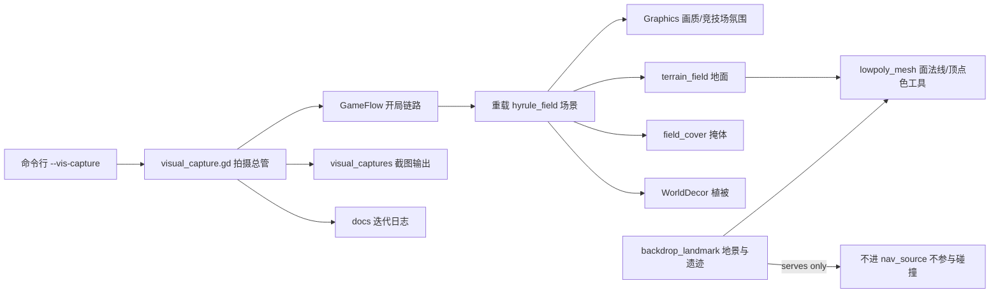

## 产品概述

为现有第三人称生存射击游戏做一次**渐进式视觉升级**，把程序化生成的地形、山体、植被、遗迹，从当前的"光滑明快的块状场景"改造成统一的**暗色低多边形雕塑风格**：阴天厚云、气氛透视、大型明确切面、巨型轮廓构图、克制冷灰色彩。所有表现继续由程序生成，不引入任何外部美术资产。

## 核心功能

- **固定视觉测试设施**：建立固定的测试场景与固定相机，支持一键运行、自动截图、自动退出，让每一轮改动都能在同一套画面条件下被反复比较。
- **全球体再有必须**庞大的体面语言：地形与山体改为明确的大切面硬边形体；场地外增加巨型远景轮廓建立空间纵深；遗迹由细薄构件改造为方柱、门框、断裂平台组成的宏伟体量组合。
- **统一的低多边形明度与色秩序**：靠体面、尺度与构图建立识别性，而不是靠后处理；主角始终能从环境中被识别，不使用发光描边。
- **克制的冷色 UI 系统**（后续轮次）：深色半透明背景、简洁几何形状、冷色主调，高饱和色仅用于火焰、交互物、目标物与极重要信息。
- **迭代纪律**：每轮只针对差异最大的三个问题中最重要的 1～3 项修改，改完重新截图复核，并记录迭代日志。

## 技术栈选型

沿用项目既有栈，不引入新依赖：Godot 4.7 Forward+ / d3d12 / Jolt，GDScript，`ArrayMesh + StandardMaterial3D`，运行时烘焙 NavigationRegion3D，所有数值走 `data/game_config.json`。

**为何不引入自定义着色器作为第一步**：Godot 的 `StandardMaterial3D` 只要给每个三角形三个不共享顶点写入同一个面法线，就能得到面着色；再配合 `ARRAY_COLOR` + `vertex_color_use_as_albedo` 就能得到程序化色阶。这样零新增着色器即可落地"平面 + 顶点色 + 有向面法线"，符合 Art Direction 允许的手段清单，也避免过早引入自绘着色器带来的管线风险。

## 实现路径

**总体策略**：先建拍摄闭环，再按优先级动手。第一轮严格只动优先级前三（外轮廓 → 尺度比例 → 构图），把后处理、色彩、光照、UI 全部推后，避免用后期 플러그掩盖基础形体问题。

**关键决策与取舍**

1. **远近 Mechanisms decoupling**。地面既走走路表面又是画面主体，直接重采样会破坏三条玩法契约（敌人可走坡度、掩体挡视线、导航烘焙）。处理方式：保留高度函数与 `height_at()` 完全不变，也保留碰撞用的 1 米采样；只把**视觉网格**改成更粗采样 + 不共享顶点的三角面集合。碰撞体 rows 不变、掩体沉底与导航数据来源不变，玩法侧天然零影响。
2. **远景巨型轮廓做成场地外的背景地景环**。放在竞技场覆盖范围之外的ループ上，**无碰撞体、不加入 `nav_source` 分组**，因此既不参与 Jolt 也不参与导航烘焙；整体合并为**单个 ArrayMesh，一次绘制调用**，高度切面刻意保持 6～12 个面，鲜花 theaters 变 draws.
3. **遗迹体量通过既有挂载点扩展，而不是先动主场景**。项目当前没有 Godot 编辑器在跑（9080 未监听），优先依赖脚本挂载点与配置驱动；确实需要新节点时，再对 `hyrule_field.tscn` 做最小文本追加，并以跑图无报错作为验收。
4. **Flat 面着色是外轮廓语言的组成部分，不能推后**。若只放大体量而保留平滑法线，大而平的面仍会被渲染成曲面，"巨星感"无从建立。因此它与第一轮的形体改动同批落地。

## 实施要点

- **运行环境实测**：存在 `D:\godot_project\Godot_v4.7.1-stable_win64.exe`（在工作区外）；当前有一个 `godot-zelda` 进程在跑，执行拍摄前必须先结束它。
- **拍摄参数固定**：固定竞技场（首图 `lakefront`）、固定种子、固定等待帧数、固定相机位姿与视场角、固定是否显示界面，保证每轮画面可比。
- **画面采集时机**：必须在渲染提交后再取画面缓冲，否则截到的是上一帧或空帧。
- **确定性观察**：拍摄模式下不生成敌人、关闭 Autonomous AI，避免每次构图不同；所有布局仍然来自既有确定性生成器。
- **日志而非猜测**：每轮把"差异最大的三个问题 / 本轮改了什么 / 下一轮判点"写进迭代日志，避免口头 LinkedList 丢失。
- **性能预算**：面数上升但顶点量仍然很小；分屏模式会画两遍，因此远景 dicas 与遗迹都保持合并网格，不新增逐株式节点与逐株式材质。

## 架构设计



**职责划分（严格单一职责）**：

- `lowpoly_mesh.gd`：只负责"给三角形集合 → 得到平面法线、顶点色、合并网格"的几何工厂，被地面与地景共用。
- `backdrop_landmark.gd`：只负责场地外远景山环与巨型遗迹。
- `visual_capture.gd`：只负责拍摄与契约自检输出，默认完全不介入游戏逻辑（无启动参数时立刻返回）。

## 目录结构

```
d:/godot_project/godot-zelda/
├── project.godot                     # [MODIFY] 新增一行 autoload VisualCapture，放在 Graphics 之后；主场景不变
├── data/game_config.json             # [MODIFY] 新增 visual（拍摄参数）、landscape（地景参数）两段；新增 terrain.visual_cell_size
├── scripts/
│   ├── visual_capture.gd             # [NEW] 拍摄总管。读 OS.get_cmdline_user_args()，无参数立即返回；有参数则走开局链路、重载场景后等待渲染稳定、逐个固定机位截图、最后自动退出。同时调用既有玩法契约检查并打印坡度/遮挡/导航结果
│   ├── lowpoly_mesh.gd               # [NEW] 几何工厂。提供按面提交三角/四边形、生成面法线、写入顶点颜色、提交为单个 ArrayMesh 的能力；保证每个面三顶点法线一致以获得硬边切面
│   ├── backdrop_landmark.gd          # [NEW] 场地外远景地景环 + 巨型遗迹。按竞技场配置确定性生成：山脊、断崖、方柱、门框、断裂平台；远景部分无碰撞、不入导航分组
│   ├── terrain_field.gd              # [MODIFY] 视觉网格改为粗采样 + 不共享顶点 + 面法线 + 按高度/坡度的顶点色分层；碰撞仍沿用原有 1 米采样，高度函数与 height_at 一字不动
│   └── field_cover.gd                # [MODIFY] 可选：为本轮新增的大型地标提供贴地与碰撞生成入口；掩体本身的 Contrary 与高度约束不变
├── scenes/hyrule_field.tscn          # [MODIFY-可选] 仅在编辑器不可用时，追加 Landmarks 节点的最小文本改动；不改任何既有节点
├── visual_captures/                  # [NEW] 每轮截图输出目录
└── docs/视觉迭代日志.md               # [NEW] 每轮记录三个差异项、本轮改动、下一轮判点
```

## 关键代码结构

**面 configuring 工厂接口**（被地面与地景共用，是本轮的核心抽象）

```
class_name LowPolyMesh
extends RefCounted

static func begin() -> Dictionary
static func push_triangle(builder: Dictionary, a: Vector3, b: Vector3, c: Vector3, color: Color) -> void
static func push_quad(builder: Dictionary, a: Vector3, b: Vector3, c: Vector3, d: Vector3, color: Color) -> void
static func face_color(base: Color, normal: Vector3, height: float, distance_ratio: float) -> Color
static func commit(builder: Dictionary) -> ArrayMesh
```

**拍摄配置契约**（写在 `data/game_config.json` 的 `visual` 段，代码只读不写，缺项走兜底）

```
{
  "arena_id": "lakefront",
  "resolution": [1600, 900],
  "settle_frames": 90,
  "spawn_enemies": false,
  "show_hud": false,
  "output_dir": "res://visual_captures",
  "cameras": [
    { "name": "ots",  "pos": [0, 6.5, 20], "look_at": [0, 2.0, -6], "fov": 62 },
    { "name": "wide", "pos": [-34, 14, 34], "look_at": [0, 4.0, -20], "fov": 55 }
  ]
}
```

## Agent Extensions

### Skill

- **godot-dev**
- 用途：本任务属于已有项目的内容修改，按其"场景 3 modify_game"执行；提供 `build_godot_scene` 的调用约定
- 预期结果：确认为修改现有游戏；若后续需要改 `hyrule_field.tscn`，按规定一次性提交完整场景树，而不是多次原子调用

- **godot-debug**
- 用途：仅在 Godot 报错、脚本编译失败、或场景构建返回错误时启用
- 预期结果：定位到具体脚本行并修复，保证每轮截图前游戏能正常起图

### MCP

- **codebuddy-plugins-official/godot-mcp/godot-mcp**
- 用途：`get_editor_output` 取运行日志做契约自检核对；`(get_script_errors)` 仅在报错时使用；`build_godot_scene` 只在前两者需要改 `.tscn` 且编辑器已启用插件时使用
- 预期结果：确认没有编译/运行错误；若 9080 未监听则明确走"脚本 + 配置"路线，不依赖编辑器

### SubAgent

- **code-explorer**
- 用途：本轮涉及 `terrain_field` / `arena` / `navigation_region` 的调用点较多，用它确认没有遗漏调用方
- 预期结果：给出受影响调用点清单，避免地形改动波及贴图-height помощ或装饰摆放