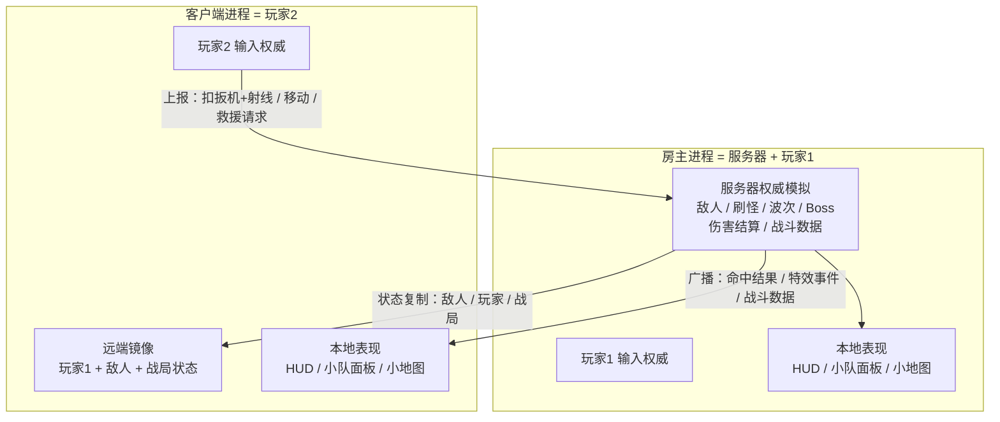

## 产品概述
把现有的单人生存射击改造成**两人联网合作**：同一张竞技场、共同面对同一批敌人与波次，各自持枪作战，队友倒地可以互相扶起。单人模式保留不变（单人就是"没有客户端连入的房主"）。

## 核心功能
- **联机合作**：一名玩家创建房间，另一名输入房间码加入；双方出现在同一张地图，能看到彼此的移动、射击、血量与姿态
- **共享战局**：敌人、波次、阶段与 Boss 由同一份战局推进，不是各自打各自的
- **服务器端战斗数据**：每位玩家的输出、击杀、爆头、承伤、命中率、存活时间由服务器统一记录，保证所有人看到的数据一致；其他玩家可随时查阅
- **常驻小队面板**：屏幕角落一直显示每位玩家的关键数据，不需要打开菜单
- **倒地可救**：被打死后进入倒地状态并开始出血计时；队友靠近长按可扶起并恢复部分血量；超时未获救则真正阵亡；全队阵亡则本局结束并进结算
- **房间大厅**：创建房间 / 输入房间码加入 / 玩家列表 / 房主开始游戏
- **难度不因人多而失效**：敌人数与强度随人数提升，**单人时数值与现在完全一致**（供继续调曲线）
- **瞬发射击**：移除原有的弹道切换，玩家射击固定为瞬发命中

## 视觉与交互
- 队友以可与敌人区分的外观出现，头顶显示名字与血条
- 倒地状态有明显视觉提示（趴地姿态 + 出血计时环）；队友靠近时出现扶起进度条
- 小队面板位于屏幕角落，沿用现有界面一致的暗色半透明风格，每行一名玩家（名字、血量、输出、击杀）
- 结算面板按成绩列出全部玩家排名
- 大厅为简洁居中面板：创建房间 / 输入房间码 / 玩家列表 / 开始按钮
- 其余画面（HUD、准星、小地图、伤害飘字、命中反馈）保持现有观感不变


## 技术选型
- 引擎与语言：沿用 **Godot 4.7.1 + 纯 GDScript**（不引入 C#、GDExtension 或第三方库）
- 网络：Godot 高层网络 `SceneMultiplayer`（`multiplayer` API）
  - 第一阶段：`ENetMultiplayerPeer`（本机开两个实例即可验证全部同步与玩法）
  - 第二阶段：`WebRTCMultiplayerPeer`（信令 + ICE 打洞 + TURN 兜底）或 `WebSocketMultiplayerPeer`（443 中转）
- 节点同步：`MultiplayerSpawner` + `MultiplayerSynchronizer`（第一阶段）；保留"服务器打包敌人快照 RPC"作为后备方案
- 配置：沿用 `data/game_config.json` + `scripts/game_config.gd`
- UI：沿用 `Control` 代码构建 + `scripts/ui_theme.gd` / `theme/game_theme.tres`

## 实现方案

### 总体策略
**Listen Server（房主 = 服务器 + 玩家）**。单人 = 没有客户端连入的房主，因此**单人模式与联机走同一套代码**，不需要维护两条路径 —— 这是"保留单人模式"最省成本的做法。

### 关键决策

**1. 权限划分（整个改造的骨架）**

| 归属 | 内容 |
|---|---|
| 服务器权威 | 敌人位置/血量/AI 决策、刷怪与波次、Boss、**伤害结算**、玩家血量与倒地状态、救援进度、掉落、竞技场与阶段推进、**战斗数据统计** |
| 客户端权威 | 本地玩家的输入与移动/朝向、相机、准星、UI、音效、粒子 |

**2. 射击链路**：客户端只上报「扣扳机 + 视线射线」，服务器校验（射速、弹药、瞬发命中）并在服务器侧结算伤害与击杀，再把结果与特效事件广播。因为本轮删除了弹道切换、玩家射击固定为瞬发，**不需要同步高速弹丸** —— 联机里最难的一块被提前消掉了。

**3. 不暂停场景树**：现有主菜单/结算靠 `get_tree().paused` 实现（`game_flow.gd` 里 14 处），联机时不能暂停别人的世界。改为"世界继续跑，只门控本地输入与 UI 层"，单人模式也走这条路径，避免两套逻辑。

**4. 地形零同步**：竞技场几何由确定性生成器算出（种子 = 竞技场 id 哈希），各端结果逐点一致（已实测 1163 / 1005 / 1088 / 750 多边形）。联机只需同步"当前竞技场 id"一个字符串。

**5. 静态工具类的角色切分**（避免"客户端也去结算伤害"）
- 只在服务器调用：`ballistics.gd` 伤害结算、`survival_director.gd`、敌人脚本的 AI/扣血、服务器侧实体池
- 各端本地调用且不参与判定：`combat_fx.gd`、`impact_spark.gd`、`damage_number.gd`、`hit_marker.gd`、`audio_manager.gd`、`minimap.gd`
- 切分方式：新增 `net_role.gd` 单点定义权限语义，调用点显式判断并在注释写明理由

**6. 人数缩放数据驱动**：每个竞技场加 `scaling` 表（按人数 → 刷怪量 / 敌人血量 / Boss 血量 / 刷怪间隔倍率），**1 人恒为 1.0**，保证用户正在调的曲线逐值不变。

### 性能与可靠性
- 敌人同步先用 `MultiplayerSynchronizer`（正确且简单），**可测量判据**：2 人 1500 帧内平均上行 < 20 KB/s、服务器帧时间增量 < 1.5 ms、敌人位置插值无可见抖动。超出才改写"每帧打包敌人快照 RPC"
- 敌人总量已受 `survival_director` 约束；对象池需按归属拆分（本地表现池 / 服务器实体池），并在切换竞技场（场景重载）与退出时按归属清理
- 反作弊边界：只做服务器侧射线与射速/弹药校验，**不做移动回滚与反瞬移**（合作 PvE，避免范围失控）

### 避免技术债
- 复用已有的 `EventBus`（autoload）作为"服务器事件 → 本地表现"的挂点，不新造消息系统
- 复用 `arena.gd` 确定性生成，不新增地形同步
- `player_hud.gd` 已由 `player.gd` 自己创建 → **每人一份 HUD 天然成立**，不需要分屏改造
- 传输层抽成可替换适配：第一阶段 ENet，第二阶段换中转不动上层

## 实现注意事项
- **不要改手感数值**：用户正在自行测试难度曲线。人数缩放表 1 人倍率固定 1.0，并用探针逐值回归（比对改造前后 1 人下的刷怪量/间隔/血量档位）
- **`GameFlow` 去暂停化要小心**：14 处 `paused`/`process_mode` 牵涉主菜单、结算与鼠标捕获；改为输入门控 + UI 层可见性后，必须保证单人流程体验不变（菜单里不该能开枪/移动）
- **Player 节点要改为服务器 spawn**：`scenes/hyrule_field.tscn` 里现在是单个 Player 节点。用 `MultiplayerSpawner.spawn_function` 以**代码构建**方式生成，不新增 `.tscn`，与项目"能用代码建就不用场景"的既有习惯一致
- **`object_pool.gd` 静态单池**：多玩家 + 竞技场切换（场景重载）下，池化节点脱离场景树、不会被场景释放顺带回收 → 必须明确每种 key 的归属与清理时机
- **RPC 安全**：所有上报型 RPC 必须在服务器侧校验（`multiplayer.get_remote_sender_id()` + 射速/弹药/距离/存活状态），不信任客户端参数；播报型一律用 `rpc` 广播，不允许客户端互连
- **保持既有校验链路**：`--check-only` 静态检查 → headless 冒烟 → 探针回归 → 导出产物实跑；临时探针用完即删（含 `.uid`）

## 架构设计



## 目录结构

```
godot-zelda/
├── project.godot                    # [MODIFY] 注册 NetSession autoload；删除 T 键输入绑定
├── data/
│   └── game_config.json             # [MODIFY] 新增 net（传输/端口/最大人数/大厅）、players.scaling（人数倍率表）、ui.squad_panel（常驻面板字段与位置）
├── scenes/
│   └── hyrule_field.tscn            # [MODIFY] 移除内嵌的单个 Player 节点，改由服务器 spawn
├── scripts/
│   ├── net_role.gd                  # [NEW] 权限语义单点定义：is_server / is_authority / local_peer_id。所有"这里该不该判服务器"的调用都走它，避免判定逻辑散落
│   ├── net_session.gd               # [NEW, autoload] 会话管理：host / join / close、玩家注册表（peer_id → 槽位与名字）、查询当前角色与人数。上层不直接碰 MultiplayerPeer
│   ├── net_transport.gd             # [NEW] 传输层接口（create_server / create_client / close / describe）。上层只依赖它，换传输方式不动游戏逻辑
│   ├── net_transport_enet.gd        # [NEW] ENet 实现（第一阶段：本机双实例验证）
│   ├── net_transport_relay.gd       # [NEW] WebRTC 或 WebSocket 中转实现（第二阶段）
│   ├── lobby_ui.gd                  # [NEW] 大厅：创建房间 / 输入房间码 / 玩家列表 / 开始。复用 ui_theme.gd
│   ├── squad_director.gd            # [NEW] 服务器侧队伍状态：每人血量、ALIVE/DOWNED/DEAD、救援进度、全队阵亡判定、战斗数据累计与快照序列化
│   ├── squad_panel.gd               # [NEW] 常驻小队面板（屏幕角落）：按服务器快照显示每人名字/血量/输出/击杀；倒地与救援进度提示
│   ├── game_flow.gd                 # [MODIFY] 去暂停化（世界继续跑，仅门控本地输入与 UI）；接入大厅；结算改由"全队阵亡"触发；挂接网络事件
│   ├── player.gd                    # [MODIFY] 输入权威与门控；删 T 键；血量与姿态由服务器驱动；射击改为上报；倒地/救援表现；受击上报
│   ├── player_weapon.gd             # [MODIFY] 删除瞬发/弹道切换与 ballistics_changed 信号；弹药与射速由服务器校验；扣扳机走上报
│   ├── bullet.gd                    # [DELETE] 玩家飞行弹退役（瞬发后无调用方）
│   ├── ballistics.gd                # [MODIFY] 明确"只在服务器结算"；命中结果与特效事件通过广播下发，本地只做表现
│   ├── survival_director.gd         # [MODIFY] 仅服务器运行；刷怪量与间隔按当前人数读竞技场 scaling 表
│   ├── enemy_spawn_point.gd         # [MODIFY] 仅服务器生成；敌人经 MultiplayerSpawner 复制到各端
│   ├── melee_enemy.gd               # [MODIFY] AI 与扣血仅服务器；位置由同步器复制；命中玩家改为向服务器上报
│   ├── ranged_enemy.gd              # [MODIFY] 同上；开火判定与视线检查仅服务器
│   ├── grenade.gd                   # [MODIFY] 客户端请求 → 服务器生成并复制
│   ├── shockwave.gd                 # [MODIFY] 同上
│   ├── combat_fx.gd                 # [MODIFY] 明确为本地表现层：由"命中结果事件"驱动，不再自行判定
│   ├── object_pool.gd               # [MODIFY] 池按归属拆分（本地表现池 / 服务器实体池）与清理时机
│   ├── player_hud.gd                # [MODIFY] 接入小队面板与倒地/救援提示
│   ├── arena.gd                     # [MODIFY] 新增 get_scaling(params, player_count) 读取竞技场人数倍率表
│   └── save_manager.gd              # [MODIFY] 服务器端战斗数据持久化；与既有"最好成绩"区分开
```

## 关键代码结构

```gdscript
# net_transport.gd —— 上层只依赖这四个方法，换传输方式不动游戏逻辑
extends RefCounted

## 作为主机开服。OK 表示成功。
func create_server(port: int, max_players: int) -> Error
## 作为客户端连入。address 可以是 IP（ENet）或房间码（中转）。
func create_client(address: String, port: int) -> Error
## 断开并释放底层 peer。
func close() -> void
## 供 UI 显示的一句话描述，例如 "ENet 直连 :7777" / "中转房间 ABC123"。
func describe() -> String
```

```gdscript
# net_role.gd —— 权限语义的唯一定义处
extends RefCounted

## 本进程是否是权威（房主 / 服务器）。单人时恒为 true。
static func is_server() -> bool
## 该 peer 是否由本进程完全掌控（单机时恒真；联机时只有服务器与自己）。
static func is_authority(peer_id: int) -> bool
## 本机玩家的 peer id。
static func local_peer_id() -> int
```


## Agent Extensions

### MCP
- **codebuddy-plugins-official/godot-mcp/godot-mcp**
  - Purpose: 每个阶段收尾用它扫描编译与运行时错误 —— 本项目会同时改动 42 个脚本中的十余个（`player.gd`、`ballistics.gd`、`game_flow.gd`、敌人脚本等），GDScript 的编译错误会连带影响 `preload` 链，必须逐个清零
  - Expected outcome: 每个阶段结束时 `get_debug_errors` 返回 0 条未解决错误；对报错脚本用 `get_script_errors` 拿到行列与上下文后修复；用 `get_editor_output` 确认运行时无脚本错误与 `RPC` 相关告警

### SubAgent
- **code-explorer**
  - Purpose: 做一次只读的"权限审计" —— 普查全部静态调用点，逐条判定应归服务器还是本地表现（尤其是 `ballistics.gd` / `combat_fx.gd` / `object_pool.gd` 这三个全静态工具的全项目调用者），并列出所有需要加 `net_role` 门控的位置
  - Expected outcome: 产出一份"文件 + 行号 + 归属结论 + 判定理由"的清单，作为服务器权威改造的施工图，避免遗漏调用点导致客户端重复结算伤害
