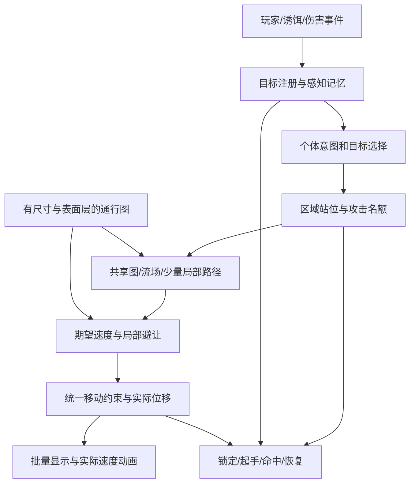

# 大量敌人独立审查与优化方案

> 版本提示：第 1–10 节保存首次审查时的实现与证据。之后副本已有后续提交；2026-10-28 截图反馈的最新核查见第 11 节。第 12 节是同一天按第 11 节实施修复后的同坐标复测（已改动源副本），不把旧问题未经复核套用到新版本。

日期：2026-10-28。对象：`D:/Godot/_lab/MFGG-pr14` 当前工作副本，包括用户尚未提交的内容。

**结论：保留批量数组与 MultiMesh；保留共享流场，但收窄它的职责。优先修正通行、目标、移动、攻击之间的合同，再做静态预计算和预算调度。最终采用“共享路线/流场 + 有容量的接战区域 + 统一移动约束 + 少量特殊单位精确规划”的混合架构。现在不建议把所有怪换成完整 NavigationAgent/CharacterBody，也不建议继续靠叠加排斥力、绕行偏移和瞬移补丁改善观感。**

本轮已完成独立代码审查、四项既有测试复核、针对性缺陷复现和一项算法等价 A/B。没有修改源副本的游戏代码、场景或配置；新增/更新的仅为审查文档与问题登记。隔离副本的新增探针和实验缓存实现留存为证据，不是已接入的优化。视觉和手感未验收。

## 1. 目标、约束和证据边界

- 用户目标：大量敌人寻路可靠、索敌合理、行为好看，同时保持性能；不是单纯提高某个寻路函数的速度。
- 已知现状：主工程是 Godot 4.7.2、Jolt；主场景为 `scenes/sanctum_main.tscn`。本轮用副本自带可执行文件实测。
- 必须保留：独立副本的既有用户修改；炮灰批量渲染的优势；物理/攻击/受击的玩法语义。
- 待验证假设：流场算法本身不适合；索敌是主要 CPU 瓶颈；每个敌人都必须拥有导航节点。当前证据均不足以支持这三个结论。
- 尚未确定：最终同屏数量、最低配置、渲染分辨率、是否要求多层建筑/桥下通行、是否多人或诱饵。方案以 100/500/1000 体为测量档位，不把它们说成用户已要求的规格。
- 本轮不做全系统重写；方案的实施批次尚未启动。后文预算是候选验收目标，不能当成已经达到的性能。

## 2. 实际运行链：不能混用测试结论

| 链路 | 当前入口与执行方式 | 审查判断 |
|---|---|---|
| 正式普通近战/远程 | spawner → `melee_enemy.gd` / `ranged_enemy.gd` → `NavSteering` → `CombatSpatialController` / NavigationAgent | 有自己的目标、身体移动及战术逻辑；不能代表纯数据炮灰 |
| 节点版泥土傀儡 | `procedural_mud_golem.gd`；可注入静态共享 `flow_field` | 流场远程追击和原战术链并存；默认 `flow_cheap_distance=8m` 外可关闭碰撞并直接贴地移动 |
| 纯数据炮灰 | `tools/probes/sanctum_golem_playground.gd --fodder=on` → `FodderField` | 数组保存状态，一个 MultiMesh 显示，无逐只 CharacterBody；自己的地图、目标、攻击和碰撞查询 |

检索到的 `FodderField` 实例化入口主要是上述试玩脚本及测试。不能把其优化自动算作正式刷怪链已经优化，也不能拿旧节点版压力报告证明当前纯数据炮灰性能。`setup` 传入的外部流场随后会被 `_init_surface_flow` 创建的表面流场替换，A/B 必须验证实际活跃对象。

## 3. 已确认的问题，按优先级排序

### P1-A：导航目的地与伤害目标混用，可产生远距离/隔层命中

`fodder_field.gd:455–457` 在玩家不可直接跟踪时，将局部变量 `target` 换成流场的地面替代点；`:489–491` 据它计算水平距离；`:526–535` 最终却对真实 `player` 调用伤害。

隔离复现：玩家在水平距离 **49m**、且与炮灰有高度差的位置；炮灰位于替代点附近，完成起手后仍调用一次伤害。配置攻击距离仅 **2.5m**。这是构造的分支复现，证明实现允许该错误，不表示正常游玩每次都出现。

即使没有替代点，当前命中也缺乏高度及遮挡验证。起手阶段每帧先把 yaw 对准目标，再计算朝向点积，使该角度检查对非零目标向量几乎恒成立，侧向躲闪读招的意义被削弱。目标 `health=0` 但节点仍在时，本轮也复现了继续发起伤害调用；真实玩家接收函数可能另行拒绝，因此不能把“伤害调用”写成“确实扣血”。

**处理：**分开 `target_id`、感知位置、`navigation_goal`、`attack_aim`；攻击只检查真实合法目标。起手前/命中时复核存活、距离、高度、遮挡；按招式设有限转向和锁定时点。共享“命中几何与目标资格”规则，批量实现不必实例化逐只攻击节点。

### P1-B：攻击并发上限没有真正成立，且有固定索引偏向

`fodder_field.gd:467` 每帧从 `active=0` 开始，在遍历中边发现已有攻击者边批准新起手。排在后面的已有攻击者尚未计数时，前面的新请求已经拿到名额。

隔离复现：前 8 个单位可起手，后 8 个已处于 WINDUP，单次更新后 **16 个单位同时 WINDUP**，而上限为 **8**。固定数组顺序还缺少等待年龄公平性。这个计数器不能替代正式链已有的攻击队列。

**处理：**先统计/回收全部有效令牌，再统一批准请求；令牌绑定实体代次与目标，死亡、击退、换目标、取消攻击时释放。把队列合同改为既支持节点也支持实体 ID，保留每目标并发数、每时间窗起手数、等待年龄和技能容量。不要让“减少攻击数量”和“移动到能攻击的位置”共用一个含糊开关。

### P1-C：流场规划的合法边与输出方向不一致

`flow_field.gd:212` 在建场时调用 `_edge_allowed`，但 `direction_at` (`:363–393`) 仅选较低距离邻格，没有复用同一条合法边检查。两个格子各自可达，不等于它们之间可跨越。

使用当前 `sanctum_walkability.json` 和默认 MovementProfile，逐格检查实际输出：

| 目标 X/Z | 有方向的可达格 | 输出边被自身 `_edge_allowed` 拒绝 | 输出边中点在细网格为 blocked |
|---|---:|---:|---:|
| 0 / 0 | 6247 | 77 | 39 |
| 67 / 38 | 6247 | 39 | 39 |
| -30 / 20 | 6247 | 55 | 33 |

两类违规可重叠，不能相加当成独立单位数。它们是导航数据上的合同违规，不是录像中穿墙次数。

根因还包括：1m 表面网格被点采样成 2m 流场，边中间没有检查 blocked；对角仅检查粗格侧邻。由此会遗漏中间障碍。单纯加大推离力不能修复拓扑错误。

**处理：**预计算带尺寸/能力约束的合法边和代价；规划、流向、插值、快捷直走、局部移动都使用同一合同。建场时保存合法 successor 或使用 `edge_cost + integration_cost` 选后继；无有效后继必须返回明确不可达/等待，不能无条件退化成直冲玩家。

### P1-D：碰撞“推出”分支读取了 API 没有返回的字段

`fodder_field.gd:683` 调用 `intersect_shape`，`:707–710` 却读取 `normal` 和 `point`。在副本自带引擎的实际盒体/胶囊相交查询中，返回键是 **rid / collider_id / collider / shape**。当前默认回退得到零法线与 `center-center`，该重叠分支无法形成推出量。

这与 [Godot 官方 PhysicsDirectSpaceState3D 文档](https://docs.godotengine.org/en/stable/classes/class_physicsdirectspacestate3d.html) 相符：接触点对可用 `collide_shape`；`get_rest_info` 提供单个接触的法线/点；`cast_motion` 不负责解决初始重叠。不能只替换一个 API 就宣称获得完整多接触解算。

同时，`:647–649` 在 `step_ok` 为真时跳过扫掠，其中包括高度变化为零的普通平地；稀疏格图不能替代平地薄墙的实际安全检查。击退分支 `:514–525` 也直接积分位置，没有经过普通移动的扫掠。

**处理：**把移动统一成“期望速度 → 可行速度/位移 → 扫掠和滑动 → 支撑与有限穿透恢复”。台阶应是验证过的上抬、前移、落地动作，不能通过停用碰撞实现。击退也走同一通行安全合同。

### P1-E：运行期瞬移掩盖不可达，脱困还有坐标语义错误

- `fodder_field.gd:408–415` 在单位不可达时直接改位置；`:427–434` 的卡住恢复和 `:236–254` 的 blocker 恢复也可直接重设位置。搜索半径最大可到几十米，且没有验证原位置到候选点之间的连续通路。
- `_choose_escape_direction` (`:213–220`) 接受世界目标并减去 pos；两个调用点 `:641/:657` 传入已经是 `target-pos` 的 `to`，实际评分变为 `target-2*pos`，地图平移会改变本应不变的脱困选择。
- 对一个本来就被流场标成可达的卡住单位，`nearest_reachable` 优先返回当前粗格中心，未必构成真正绕障路线。

**处理：**出生合法化与运行脱困分离。正常运行采用检测真实进展 → 保持绕行侧/让行 → 小范围路径 → 明确不可达策略；可见区域不以瞬移作为寻路成功。若设计允许远处回收/重生，使用独立事件并从导航成功率剔除。

### P2-F：近身槽位和流场互相抵消，缺少到达与容量

`fodder_field.gd:564–572` 在 14m 内用强度 1.35 的直线槽位向量混合强度 0.35 的流场，只检查槽位终点是否 blocked，不检查通路。可能出现流场要求先后退绕墙，槽位却强迫向前压墙。

槽位半径是 **2.75 / 3.65 / 4.55m**，攻击阈值是 **2.5m**。当前没有完整的占位预约、入场路径、到达减速和“等待位转攻击位”过程。`:618` 将最终向量归一化，无法保留接近终点时应该减速的幅度；移动分支 `:719–721` 无条件更新行走表现，可能在实际不动时仍踏步。

**处理：**将槽位升级为沿可达地面生成的扇区/区域：等候区、接战位、退出区分开；分配时考虑入口、容量、到达成本和占用时间。圆环只在开阔地作为候选生成方式，不把整圈固定圆当成通用战术。优先就近稳定分配，不让所有单位穿过玩家争抢对侧槽位。速度含到达减速，动画用实际位移速度驱动。

### P2-G：MovementProfile 暴露的能力不等于实际参与判断

`flow_field.gd:122` 将坡度相关结果写入 `_step_height`，该变量在当前文件只有赋值没有读点；边检查实际使用 `_edge_step`。当前炮灰链也没有把 `profile.radius` 贯通到烘焙/运行胶囊：烘焙点探测偏移固定 0.32，运行胶囊固定 0.42。`can_jump/can_fly` 不构成这一链已经支持跳跃/飞行的证据。

烘焙以单个 XZ 位置保存地形、上表面和行走高度，且以地形高度附近的固定查询生成可通行性，无法表达任意桥上/桥下同时通行的多层拓扑。JSON 检查主要是格式号及数组规模，没有地图碰撞源/能力版本的内容指纹，文件能加载不等于与当前场景一致。

**处理：**仅声明真正支持的移动能力；尺寸、坡度、台阶、净空一起构成 profile key。对当前单层场景先统一图与身体；有多层需求时引入 surface/layer ID 和显式连接，不能继续向单高度网格填例外。

### P2-H：静态采样重复进入每次流场重建，动态更新还有同步尖峰风险

当前实现是带权 Dijkstra 风格的堆传播，不是文件注释声称的纯 BFS。每次重建都反复执行边高度采样、方法存在性检查和贴墙代价查询。

常规重建在 worker 运行；**首次 `_init_surface_flow` 仍同步 `rebuild`**。破坏物退出后，`:395–399` 在主线程逐个 `rebake_region`，后者每次又重算全局 clearance，随后下轮重新同步初始化流场。多个临近破坏点也没有先合并脏区。

worker 引用可变 `_surface`；主线程可以更新同一表面数据。当前也未见图版本发布校验及本链完整任务回收路径。这是静态并发/生命周期风险，本轮没有复现崩溃，不把风险写成已发生事故。

**处理：**静态采样前移到烘焙/有版本的缓存；合并脏区，预算化主线程物理采样，纯数组计算再后台执行；不可变图快照 + generation/target revision 双重校验后交换结果。弃用任务仍需完成回收；不要用同步全图重建兜底每次场景变化。

## 4. 本轮等价 A/B：证明先优化现有路线有价值

实验仅在隔离副本中派生 FlowField，缓存 **8 邻边是否合法** 和 **每格贴墙代价**。保留原图、原目标、原传播代码及其现有缺陷；没有关闭障碍、减少格子或改变终止条件来换取速度。

三种目标各运行三次，交替基线与缓存版先后顺序；共九组，逐格比较全部 **6561** 项距离值：每组差异数 **0**，最大误差 **0**。

| 指标 | 当前实现 | 实验缓存版 |
|---|---:|---:|
| 单次重建中位耗时 | 807.210ms | 141.434ms |
| 九次范围 | 785.942–1257.369ms | 116.914–152.805ms |
| 一次性额外缓存构建 | 无独立缓存 | 643.671ms |
| 新增数组有效载荷 | 无 | 78,732 bytes，约 76.9KiB |

中位耗时约减少 **82.5%**，约 **5.7 倍**。计时使用原实现 `rebuild_usec`，范围是 `_compute`，不包含 `_ensure_mask`、任务排队或结果提交；缓存预计算另列。这是本机无头、同步函数耗时的微基准，不是游戏 FPS、worker 并行吞吐，也不是质量已经修复。先前与其他测试同时运行得到的 1.5–1.9 秒数据不用于本表。

**含义：**当前有明显重复静态工作，没必要先推翻流场。也不能止步于缓存：约 141ms 仍太长，首次构建还要付缓存成本。应把静态缓存离线化，修正边合同后，再根据 profile 选择预存 successor、减少动态分派、紧凑堆/桶队列、局部场或原生扩展。桶队列只在代价量化且误差验收明确后采用；不能把有权图直接改成 BFS。

## 5. 候选路线比较与明确推荐

| 路线 | 收益 | 隐藏成本/失败条件 | 判断 |
|---|---|---|---|
| A. 保留现有批量流场，修合同、做静态预计算与共享调度 | 改造风险最低；本轮已有等价加速证据 | 单 XZ 高度表无法承载复杂多层；全图多目标重建仍可能昂贵 | **第一阶段必须做，是低风险验证基线** |
| B. 所有怪回归 NavigationAgent + CharacterBody + 原完整战术 | 易复用引擎导航、真实身体运动、多层地图 | 逐体节点/物理/重规划成本；不会自动解决攻击容量与索敌语义；需要实测才能知道可支持数量 | 不作为大批炮灰默认路线；保留作同等规则的质量/性能对照及精英实现 |
| C. 批量实体 + 共享通路/区域流场 + 有限精确局部规划 | 保留低对象开销；把共享路线和个体战术分开；可扩展尺寸与表面层 | 必须统一图、碰撞、目标和版本；分区缓存复杂度增加，目标/能力组合可能爆炸 | **最终推荐；分层/分块按地图证据逐步引入** |
| D. 立即全盘 ECS/C++/GPU 寻路重写 | 有进一步降低脚本开销的潜力 | 错误合同会被完整搬过去；开发、调试、编辑器接入成本大；GPU 回读/同步需要评估 | 当前淘汰；只有热点在正确实现后仍超预算才下沉纯数据内核 |

160m 级别的当前地图，不先把整个分区流场框架做完再验证。A 修正后的整图场可以成为 C 的第一种后端；只有地图面积、目标数量、全图重建或多层需求形成实测压力时，再接入 portal/区域图和分块缓存。

[Godot 官方优化指南](https://docs.godotengine.org/en/stable/tutorials/navigation/navigation_optimizing_performance.html) 建议减少无必要重查、错开请求、控制地图多边形复杂度。不能根据 NavigationAgent 的名字就认定它必然慢，也不能根据“后台计算”就认定不会产生过期追击。

## 6. 推荐架构与每层职责

### 6.1 目标与感知：单玩家不需要先造昂贵空间检索

当前 `targeting.gd` 的“最近活玩家”每次获取玩家组并生成存活列表；若只有一个玩家，候选集本来就极小。主要问题是不同链路的语义分裂：普通近战/远程周期重选，泥土傀儡主要在目标失效时重选，FodderField 全体绑定一个 player，没经过同一资格合同。

建立一次更新的 TargetRegistry，实体保存稳定 ID、代次、当前目标、最后观察位置/时间。死亡、离开场景、阵营变化立即失效；其余重选错峰低频进行。目标评分组合资格、连通区域、廉价距离/路径代价估计、仇恨或受击事件、已有目标黏性、目标容量。只有确有大量候选目标时才加空间索引，不逐体为每个玩家跑 A*。

“全图知道玩家位置”可以是炮灰的设计选项，不应强迫所有怪使用视锥。反之，若有潜行玩法，则定义视线、听觉/受击感知、最后已知位置和丢失目标后的搜索状态。**索敌可全知，攻击仍须符合命中几何**，两者不能混同。多人/诱饵时按目标与能力共享场，设置缓存上限和淘汰策略，禁止每只怪复制一张场。

### 6.2 导航图：路线和身体使用同一份通行真相

地图预处理产出：surface/layer ID、支撑高度/法线、半径净空、允许上/下台阶、合法边、连通分量、静态代价、地图与能力签名。以碰撞几何/导航数据为来源，不把 Terrain 公式当成一切平台的真实地面。

当前单层地面可继续网格；狭窄门和障碍边需要更细或保守采样。多层楼板、桥和楼梯用 NavMesh/分层格图表达拓扑，再在区域内产生共享方向。允许不同上/下台阶时边是有向的，逆向建场必须检查反向邻接，不能默认对称。

流场 key 至少包含地图版本、移动能力、表面层和目标区域；通路缓存复用相同目标/入口。结果带生成时刻与目标版本；玩家跨区时更新通路，近身使用合法的实时局部目标。旧场仍有效时可继续用；失效且无合法备选时等待或切换策略，不能穿墙追赶。

### 6.3 战术：明确“赶路、排队、接战、离场”的不同目的

最低状态集合：未接敌/休眠、追击、接近入口、等待、接战位移动、起手、命中窗口、恢复、受击、目标丢失/不可达、死亡。不是让每种怪拥有巨型行为树，而是让状态的目标和允许动作明确。

- 追击者沿合法共享通路前进；不会因为距离到了 14m 就丢掉绕墙目标。
- 等待者停在容量允许的外围位置，适度让行/调整；不必须持续绕圈制造“活着”的感觉。
- 获得攻击机会的单位先到达可攻击位置，然后拿/确认令牌；不能因持有名额却走不到而长期锁死全队。
- 起手/恢复阶段身体有明确优先级，其他单位绕开；冷却者按需要退出，不反复抢占同一接战点。
- 玩家快速移动时，近身追击跟新目标；失效槽位逐步撤销重分配，避免整群同帧穿插。
- 玩家站高台且当前兵种到不了时，表现为去入口、围堵、等待、转目标或设计允许的攻击；不能在替代点攻击真实玩家。
- 同一类炮灰可以使用不同稳定接近侧、反应时间和起手节奏；不要靠每帧随机转向伪造行为多样性。

### 6.4 群体移动：允许减速，避免顺序相关和局部死锁

采用帧初只读位置/速度快照 → 空间桶 → 有限邻居 → 各自求速度 → 统一提交，消除当前“桶来自旧位置、邻居坐标却边读边改”的顺序偏向。密集时空间桶仍可能退化到 O(N²)，应对候选检查数、邻居数和高密度桶设置明确预算。

期望速度保留速度幅度、到达减速、转向/加速度限制；考虑短时碰撞时间与让行优先级，避免只有距离排斥。门口需要队列/通道容量；局部避让不承担全局找出口。全重叠时使用确定的成对分离方向，避免零距离排斥为零。

[ORCA 原作者资料](https://gamma-web.iacs.umd.edu/ORCA/) 可作为局部速度求解的候选；它解决相互避碰，不负责找路、分配攻击位或保证所有拥堵场景有进展。只对接战区做限邻居的 ORCA/采样速度与轻量分离 A/B；不要默认给全部远方单位开启完整避让。

### 6.5 移动与表现：只减少计算频率，不改变通行规则

远、中、近使用相同的碰撞/支撑合同。远处可降低决策和方向更新频率并插值，但不能简单关掉障碍约束；受击、近身危险或玩家接近立即升档，切换加入迟滞。

保留数组与 shader 动画；实体 ID 与 MultiMesh 显示索引分离。动画速度来自实际位移，区分主动等待和想走却受阻。规模变大后评估分块 MultiMesh 包围盒与可见性；用紧凑缓冲更新替代大量逐实例 API 调用前先测 RenderingServer/GPU 是否真是瓶颈。

现有热循环仍有每 4 帧贴地射线、每 3 帧避障射线、每 2 帧 shape/point 查询，以及可选扫掠和脱困视线。对持续移动且查询无重叠的 N 体，仅这些基础项约为 `N/4 + N/3 + N/2 + N/2 ≈ 1.58N` 次查询/物理步；这是代码频率估算，**不是本轮 profiler 计数**。去掉 CharacterBody 不等于去掉了逐体物理成本。

## 7. 分批实施、产物与停止条件

| 阶段 | 范围与交付 | 放行条件 |
|---|---|---|
| P0 基线与复现 | 固定入口、地图/能力签名、随机种子、目标轨迹；补导航/攻击/查询计数与事件日志 | 可区分正常走到、出生投影、穿透纠正、运行瞬移；结果可重放 |
| P1 正确性 | 修真实攻击目标、并发令牌、法线 API、脱困坐标；统一合法边；停止用瞬移冒充到达 | 本轮全部反例转为禁止错误行为的回归；平移不变性成立；正常游玩不产生非法命中 |
| P2 低成本性能 | 静态边/代价离线缓存、图版本与线程快照、脏区合并、预存后继、错峰预算 | 与正确基线比较可达性/路线代价；移动目标新鲜度和主线程尖峰达标；含冷启动与破坏时刻 |
| P3 群体与接战 | 两阶段移动、有限邻居、到达减速、区域容量、稳定槽位、等待公平与转向锁定 | 窄门有吞吐；单目标不吸成一点；侧向躲闪有效；等待者不永久饿死；人工录像评审 |
| P4 有证据再扩展 | 分块/分层图、目标类别共享缓存、近区局部路径；必要时把纯数组内核迁至 GDExtension | 100/500/1000 同规则对照；复杂地图和多目标收益超过缓存/调试成本 |

P0–P3 做完并不自动要求 P4 全部实施。若整图正确缓存版已经满足目标，就保留更简单的实现。若通行图仍错误，不继续用调速度/增排斥掩盖问题。

## 8. 测量与验收设计

### 8.1 最小质量矩阵

开阔地追逐；直角墙与 U 形凹区；单/双入口；窄门瓶颈；坡、低台阶、不可上平台；可破坏障碍；玩家高速折返/绕柱；目标死亡/切换；出生错误点；受击将单位推向薄墙；多层区域（若玩法需要）。各使用 100/500/1000 数量档和固定种子/轨迹。

至少比较 A（修正后的现有共享场）、B（同规则原生导航基线）、C（共享场+局部区域调度）。有余力再做消融：无显示、无攻击、无邻居、无贴地/物理查询，仅作为定位工具，不能把关闭正确性约束后的 FPS 当交付成绩。

记录到达率/路径进展、P95/P99 停滞时长、路径长度比、门口单位吞吐、方向反转、最大重叠/穿透、运行瞬移次数、错误命中、起手数量/同时数量、等待时间分布、切目标频率。停滞须排除合理等待/攻击恢复；到达时限随合法路线长度与速度设置，不能固定 4 秒要求所有远端单位抵达。

硬门槛：非法攻击 0；超名额 0；合法边违规 0；正常运行瞬移 0；单位不能因为 LOD 穿越封闭墙。动态障碍临时截断时，安全停等可接受，必须记录原因而不是伪报到达。

### 8.2 性能拆分

同机固定分辨率、相机、种子、目标轨迹，预热后测至少 60 秒，重复三轮；冷启动与大批破坏单独统计。全帧 wall time 与物理追帧、CPU/GPU 分开；固定帧无头功能测试不用于 FPS 宣称。

拆分目标/感知、场重建、worker 排队和结果年龄、邻居候选、运动/物理查询、攻击、显示提交。报告中位/P95/P99/最大值、查询次数、缓存命中/内存和每档单位数。降频不能只让帧率升高却让反应迟钝。

若以 60FPS 为项目目标，可先试定：500 体时敌人相关主线程 P95 ≤4ms，近身事件响应 ≤100ms，共享场端到端年龄 P95 ≤200ms，正常场景总帧 P95 ≤16.7ms；这些是**待按最低配置校准的拟议门槛**，不是本轮承诺。1000 体作为压力档；不得靠丢物理时间或减少实际单位数满足指标。

### 8.3 为什么现有测试通过仍不能证明体验好

本轮四项脚本都输出功能 PASS：烘焙表加载；地面净空 14,400 个单位帧样本、最大下陷 0.030m；blocker 恢复 blocked=0、unstuck=19；15 个点的 reachability 全部通过，4m 内数量为 23–39/100。

但 reachability 只要求 4 秒后至少 **5/100** 进入 **4m**，并未区分真正走到还是位置纠正，也没有检查全部存活者的路线进展。blocker 用例还明确要求发生 unstuck。它们能证明局部断言，不能证明连续可靠的追击、没有瞬移、不卡门或攻击公平。

自动验收整体没有通过：引擎报告 `Failed to read the root certificate store`，启动器按原规则标记失败；未删除/忽略此错误来制造全绿。源副本目录检查原本也有 535 条问题，主要为独立副本缺少外部历史产物/链接等；未为本任务修复无关问题。因而本轮复用启动器的 `isolate_project` / `run_check` 做隔离诊断，单独保存目录检查结果，没有把主验收入口说成通过。

## 9. 建议的模块边界与可调参数

建议逐步把 `FodderField` 从地图+导航+移动+攻击+命中+渲染的总管缩成实体容器/入口，提取以下职责；名称仅为设计建议，尚未新增正式文件：

- TargetRegistry / TargetPolicy：目标资格、事件、记忆、切换迟滞。
- TraversalGraph / FlowService：合法图与版本、共享场缓存、任务调度。
- EngagementDirector：目标区域容量、接战位、起手令牌及公平。
- CrowdMotion：快照、空间桶、避让、统一位移安全约束。
- CombatResolver：节点/批量实体一致的命中规则。
- FodderRenderer：实体到显示索引、真实运动速度、批量上传。

不要拆出一堆只转发调用的类；先以纯数组输入/输出和明确版本数据隔离真正可独立测试的部分。迁移期间每个实体每步只有一个移动/战术控制器，避免同时启用旧近身绕行和新站位求解。

调参入口应区分：能力（半径/高度/坡度/台阶，需重烘焙或换图）；感知（距离/记忆/切换迟滞）；群体（加速/转向/让行/邻居预算）；接战（区域容量/起手率/并发/等待公平）；性能（预算/更新间隔/LOD 迟滞）；表现（动画与实际速度映射）。标单位和生效时机，参数不能看似可调却没有读取点。

观察台至少显示：当前控制链、真实目标、导航目标、攻击瞄准点、表面层、场版本/年龄、状态与停止原因、实际速度、攻击令牌和等待时间。支持固定轨迹重放、暂停、逐步观察、对照开关及显式保存；具体手感由用户看录像/试玩确认。

## 10. 证据与本轮状态

证据根目录：`D:/Godot/test-world/_artifacts/MFGG-pr14/horde_audit/20261028_112319_aff8addc/`。

- `reports/source_manifest.json`：核心实现与隔离原版 SHA256 对照，游戏代码一致；project.godot 仅为隔离运行修改用户目录、窗口及插件设置。
- `reports/focused_findings.json`、`logs/independent_horde_audit.*.log`：远距攻击、死亡目标、攻击上限、API 返回键、实际烘焙表方向扫描。
- `reports/flow_ab.json`、`logs/audit_flow_ab.*.log`：九组等价对照。
- `reports/baseline_checks.json` 和四项 `logs/test_*.log`：功能断言与引擎错误分别保留。
- `tmp/project/tools/probes/independent_horde_audit.gd`、`audit_cached_flow.gd`、`audit_flow_ab.gd`：本轮诊断与实验实现，仅保留归档，不接入正式工程。
- 首次长路径隔离复制失败的残留及源目录检查日志位于本聊天 visualization 目录的 `_artifacts/MFGG-pr14/horde_independent_audit/20261028_112300_18369cdc/`；为保留证据未自动删除。后改短路径成功完成隔离。

本轮状态：**审查和方案完成；游戏优化未实施；无完整带渲染性能结论；视觉与手感待后续实现后人工验收。** 推荐下一批工作范围为 P0+P1，不直接批准一次性全架构重写。

## 11. 围墙内卡住、贴墙穿模与异常上下移动：截图反馈续查

2026-10-28。用户反馈：“头疼，流场下小怪卡地形，就没办法了么？类似这种……一直解决不了，而且小怪在障碍物旁边蹭过的时候穿模，很多地方模型奇妙的就上去了或者钻过去了。”截图玩家坐标约 X=27.9 / Z=-35.9，100 Fodder，玩家在围墙外，怪群挤在墙内。

本轮复核的 HEAD 为 `9687187`（fix(nav): keep step-up height after snapping）。当前已经有后续提交加入静态边缓存、流向合法边检查、首次 worker 建场、真实攻击点/视线、攻击等待年龄、分离快照和邻居上限、get_rest_info 等；前文部分问题不再能原样当成当前代码。本轮不覆盖这些改动，也不将未重测部分宣称已修复。

### 11.1 当前仍存在的明确原因

1. **绕路可达不等于直线可达。** `fodder_field.gd:634–645` 现在检查槽位 blocked 和 flow.is_reachable，但没有验证到槽位的直线路径。随后仍按 0.35 流向 + 1.35 直线槽位合成方向。墙内到墙外即使能绕远路到达，也不能因此直走穿墙。
2. **模型比碰撞体宽。** 当前胶囊半径固定 0.42m；左拳中心横向 -0.6m，宽 0.28m，外侧约 0.74m；右拳同规格又放大 1.15，外侧约 0.761m。shader 的摆动围绕 X 轴，不会把横向外伸收回胶囊。故身体中心合法仍可能出现明显手臂穿墙；必须区分真实身体穿透与视觉净空不足。不能只把所有通道一律扩大半径而不验证窄门能否通过。
3. **普通平地仍可能跳过扫掠。** `:715/:733` 的 step_ok 包括零高度变化；后续单轴滑动也没有统一的最终碰撞验证。`get_rest_info` 修补后仅是在重叠后固定推出，不能替代移动前的连续碰撞约束。
4. **支撑高度由多个来源反复覆盖。** `:471–482` 用最近格上表面改 Y，`:538–545` 用射线改支撑缓存，`:711–761` 根据前方 0.6m 高度提前抬脚，再经过 snap 和 Terrain 下限。没有稳定的“当前支撑表面/合法过渡”合同，不能仅以某点有高度就认定当前身体可以站上去。
5. **运行期搬位置依然存在。** 不可达、blocked、卡住的分支仍直接改位置；绕行函数仍接收相对向量 `to` 后再减 `pos`。这些是当前代码事实，不能因新的缓存/队列优化已接入就视为解决。

### 11.2 同坐标定向复现和最小消融

通过项目提供的 isolate_project/run_check 创建最新源码的隔离副本。采用实际圣所场景、玩家固定在 (27.9,-35.9)，流场准备后将 100 体布置在墙内 x=19.0..25.12 / z=-32.5..-26.38；600 个物理步约 10 秒。第二组只在隔离实验脚本禁用 14m 近身槽位混合，其余保持原逻辑。

这不是截图操作历史的逐帧重放：截图未给出此前传送路径、全部单位位置和运行时长。因此只作为同位置、同系统的定向复现。

| 指标 | 当前实现 | 仅关闭近身槽位 |
|---|---:|---:|
| 10 秒后玩家 4m 内数量 | 69 | 73 |
| 运行期 unstuck 计数增量（不含前置初始化） | 95 | 61 |
| 相邻采样位移 >0.5m 的次数 | 98 | 66 |
| 最大单步位移 | 5.412m | 5.419m |

正常 3.4m/s、60Hz 的主动移动约 0.057m/步。此处的大跳变不能算正常绕行。关闭槽位后的末尾到达数不能解释成修复成功；仍有 61 次位置纠正，且部分中途到达数低于原版。一次消融不足以给出稳定收益，但足以否定“只关包围/只调流场强度即可完整解决”的结论。没有统计逐条物理墙体穿越，因此不把上述次数等同于穿墙次数。

引擎退出 0，生成完整观测数据；因系统证书读取错误，run_check 仍为失败状态，未宣称自动验收通过。未开图形窗口、未做最终视觉验收。本轮没有修改源副本游戏实现。

### 11.3 这个场景的修复目标与推荐边界

先建立单体→10体→100体的固定庭院回归：从墙内经真实开口出去、沿外侧到玩家；全程无运行瞬移、无穿实体、无无故切换到墙顶/地板下，手臂保持合理视觉净空。先通过单体路径与移动合同，再叠加拥挤；不能用“至少几只出来了”验收。

流场继续只负责合法通路。隔墙时禁止近身直线槽位覆盖通路；只有到槽位的通路有效时才能接管。身体运动统一由一个可靠移动器负责，普通移动/击退/滑动/台阶都经过同一安全检查。为当前 100 体建立 CharacterBody3D + move_and_slide（台阶另有明确处理）对照是合理的工程选择，仍可共享流场和批量显示；是否满足帧预算须实测，不能预设逐体身体一定太慢。若保留自定义批量移动器，就必须完整承担扫掠、多接触、支撑与台阶过渡责任，不能再用搬位置代替。

支撑面合法过渡与视觉净空要分别验收。图形录像逐段看墙角、入口、台沿；数值检查提供连续轨迹、支撑来源、碰撞与纠正事件，不能替用户宣称观感满意。

证据目录：`D:/Godot/test-world/_artifacts/MFGG-pr14/courtyard_audit/20261028_123720_e9bad35d/`。原图保存在 `screenshots/user_courtyard.png`；完整位置样本在 `reports/courtyard_ab.json`，精简指标在 `reports/courtyard_summary.json`；源码哈希在 `reports/source_manifest.json`；探针与禁用槽位的实验变体在 `tmp/project/`，仅保留归档。

## 12. 第 11 节问题：已实施与同坐标复测（2026-10-28）

用户要求按第 11 节继续优化。本轮直接在源副本 `scripts/flow_field.gd`、`scripts/prototypes/fodder_field.gd` 实施，**不改地图、不重烘焙通行表**。逐项改动、未做项和全部证据路径见[泥土傀儡-大量炮灰架构重建](泥土傀儡-大量炮灰架构重建.md#2026-10-28-第-11-节庭院问题流场边合同槽位视线与统一移动)。

### 12.1 新确认的主因

第 11.1 节五条仍然成立；其中“跳过扫掠”和“运行期搬位置”是症状，本轮新确认“整群卡死”的直接原因是**流场边合同缺了一项**：

- **流场 2m 边只查高度连续性，不查边中点的 1m blocked 格。** 庭院东侧 1m 厚墙正好落在 2m 格边中点：粗格两端都可走，流向因此穿过墙。实测末样本 46/100 永久停在 x≈24–26、朝 `(+1,0)` 顶墙，20 秒不出院；墙内到玩家其实有 SW 开口可走。
- 槽位接管只查“终点开放/可达”，不查到槽位的直线通路和槽位到玩家的视线；墙内槽位可达但打不到人，仍以 1.35 强度盖过流场。
- 贴墙切线的符号按“指向玩家”选，墙内侧等于逆着流场把单位推向墙角。
- 0.7m 台阶规则会让单位爬上薄墙顶；`nearest_reachable` 的最近点可能在墙另一侧。

### 12.2 实施要点

- `_edge_allowed` 按 0.5m 采样，除高度连续性外同时查 `blocked_at`；规划、流向、缓存后继共用同一张 1m 通行表。
- `FodderField`：
  - 统一移动器：每次水平位移都 `cast_motion`（胶囊抬 0.15m 避开坡面），被挡时用 0.6m 前瞻 + 0.9m 台面深度确认上台阶；其余按安全比例滑动。
  - 单一支撑：脚下射线定高度，上台阶后 0.3s 保持；删除 1m 网格全群 Y 重写和 4 帧贴地射线。
  - 槽位：直线可走 + 到玩家视线，否则交回流场；贴墙切线按意图方向；逃逸评分同样以意图方向为主。
  - 删除运行期瞬移与隐藏重生；只有 setup 出生合法化和首次流场就绪后的近距直线投影。
  - 重叠推出走同一扫掠、只推墙接触；分离半径/强度 1.55/1.35 → 1.15/0.9；手臂外缘 0.74/0.761 → ≈0.62。
- 新增 `tools/probes/fodder_courtyard_regression.gd`（含 1/10/100 体与旧分离参数对照）与 `tests/test_fodder_courtyard_route.gd`。

### 12.3 同坐标复测（600 物理步 = 10 秒，100 体）

| 指标 | 旧实现 | 本轮 |
|---|---:|---:|
| 运行期位移纠正 `unstuck_delta` | 97 | 0 |
| 单步位移 >0.5m 次数 | 97 | 0 |
| 最大单步位移 | 5.58m | 无 >0.5m |
| 仅竖直方向 >0.2m 的跳变 | 5 | 0 |
| 胶囊与静态几何重叠（单位帧） | 87 | 4 |
| 手臂最大穿墙深度 | 0.334m | 0.028m |
| 10 秒进入玩家 4m | 67（含瞬移） | 35 |
| 20 秒进入玩家 4m | 未测 | 79 |
| 仍在围墙内 | 7 | 0（5 秒内清零） |

`旧实现的 67` 里有 97 次运行期搬位置，不能当作走出来的。同轮 10 只从真实开口出去（墙内 0 只；7 只 10 秒内到 5m）；单体在另一轮复测里曾在西开口楔住（I-394，未修）。旧分离参数同条件只有 19–22/100 到 4m、5–15 只仍在墙内。探针同条件帧耗中位 22.8–23.5ms → 13.5–15.4ms；旧版这 97 次搬位置本身就是大头，只能当同条件对照，不等于正式游戏 FPS。

### 12.4 仍未解决

- 未开图形，视觉与手感未验收；第 12 节里“把模型收到 0.44m”是中间实验，**已按用户要求在第 13 节恢复原模型并扩大胶囊**（I-390）。
- 窄口/接战容量：容量最小版（跟车让行）做了两版 A/B，10 秒 30→6 / 35→20，20 秒 79→30 / 80→69，均否决并回退。本场景的限流是西开口拐角 + 20–25m 绕行，不是门洞缺令牌；正式“区域+优先级+释放”容量版未做（I-392）。
- 单体在庭院西开口可能楔住（solo 变体 8 秒不动，10/100 体靠人群推挤通过），疑为初始重叠让 `cast_motion` 全 0 或烘焙 0.32 探针与 0.42 胶囊不一致（I-394，未修）。
- 2m 流场格按格子左下角采样 1m 通行表，庭院内 10/100 出生格被判不可达（I-393）；`profile.radius` 未贯通烘焙与运行胶囊，`_step_height` 仍无读取点（I-387）。
- 多层图、分块缓存、ORCA 速度求解、区域容量仍是 P3/P4 范围。

证据：
- 旧实现基线：`D:/Godot/_lab/_artifacts/MFGG-pr14/courtyard_fix/20261028_125421_43e597f8/`
- 流场边修复前（46 只死锁）：`.../courtyard_fix/20261028_131235_136c0d23/`
- 流场边修复后（墙内清零）：`.../courtyard_fix/20261028_131816_73abbc8f/`
- 终版变体套件（solo/squad/current/wide_sep/long）：`.../courtyard_fix/20261028_132259_c2bfb21f/`
- 最终 6 项导航测试（庭院测试为 600 步版）：`.../courtyard_fix/20261028_140058_97557110/`
- 庭院回归测试定版（720 步，9/10 到 5m）：`.../courtyard_fix/20261028_140438_fdf19aa1/`
- 容量实验 A（按距离让行）：`.../courtyard_fix/20261028_134502_b04b1634/`；B（只跟慢慢者）：`.../courtyard_fix/20261028_134853_c5c9e5a5/`；回退后终版：`.../courtyard_fix/20261028_135332_c37044c5/`

## 13. A 方案落地：恢复 0.74 体型、0.76 胶囊、统一烘焙（2026-10-28）

用户明确要求“不缩模型”，按 0.76m 身体重做，窄门过不去就承认：

- **模型/胶囊/烘焙同源**：拳外缘恢复 0.74/0.761m；运行时胶囊 0.76/1.6m（中心 +0.2，扫掠抬 0.22）；walkability 升到 format 2，`body_radius=0.76`、`body_height=1.6`、`body_lift=0.22`，每格用胶囊在格心 + 四边中点 5 点测试，脚参考用 `walk_heights`，烘焙前清敌人/导演/玩家碰撞层。blocked 1277（4.9%）→ 3743（14.4%）。
- **移动合同**：分离 1.7/1.1（> 1.52m 直径）；下一格 blocked 不迈入（已在 blocked 格内允许走出）；出生 blocked 搜索 8→12；新增台体内部出生投影。
- **结果**：手臂穿墙 0 帧、胶囊重叠 0 帧、blocked 存活单位 0；6 项导航测试全 PASS；庭院 10 体 10/10（12s、0 瞬移/穿透）。100 体 10s 12/100、20s 56/100 到 4m（0.42 身体时代为 35/81）：因为西开口（约 1.6m）对 1.52m 身体关闭，流场改走北侧约 30m。
- **边界**：这是用户接受的“体型大了过不去”，不是 bug（I-398）；覆盖率守则改为身体相关（>95%、最大孤立块 <150、孤立 <1000）。仍未修 Claude 复核的 I-395/396/397（零方向直冲、下落限幅、支撑射线起点）。

证据：烘焙 `.../courtyard_fix/20261028_142636_b1cdc799/`；6 项测试 `.../courtyard_fix/20261028_144241_158adfad/`；100 体套件 `.../courtyard_fix/20261028_144704_81716ee5/`。

## 14. F7 岩石坡复核：不可达目标与出生嵌石头（2026-10-28）

用户 F7 截图：玩家点进 `(58.2,-9.4)` 的岩石坡（HUD `reachable=false`），部分炮灰卡在坡/石堆。point 探针同坐标复现：

- 修复前：100/100 单位不可达、`flow_cells=1`、body overlap 266–356 单位帧、手臂最大深插 0.745m。
- 根因：① 玩家格不可走时流场退格落在“边不连通”的袋（只看 mask 邻接，不看 `_edge_cache`），整群零方向后直线冲玩家；② 出生环可把单位放进“格心放不下、但格内某点放得下”的岩石内部，出生合法化不搬。
- 修复：FlowField 用与 Dijkstra 同一张边缓存算主开放连通区退格；FodderField 新增出生体测试投影（与扫掠同一抬升）。
- 复测：`spawn_unreachable` 100→5、`flow_cells` 1→5493、body overlap 356→123、手臂深插 0.745→0.296m；6 项测试全过（`.../courtyard_fix/20261028_155421_f7e8994f/`）。
- 剩余：I-396 下落限幅（复测仍见 1 次 1.585m 竖直跳变）；123 帧是岩石边缘未抬升胶囊的接触，移动合同未穿墙；玩家站位不可达时单位停在可达边缘属正确等待。

## 15. 导航算法与数据分离（2026-10-28）

- **数据**：`data/navigation/sanctum_nav.json` 管地图/网格/流场/重建/烘焙；`data/navigation/fodder_movement.tres` 管单位身体与移动参数。
- **算法**：`FlowField.configure(nav.flow, extent)`；`WalkabilityGrid.configure_body/rays` 且身体/射线字段随 JSON 存取；`FodderField.setup(..., nav_data)`；烘焙工具 `--nav=`。
- **删掉的硬编码**：`CELL_SIZE/WALL_MARGIN/WALL_PENALTY/MAX_SLOPE_COS/Terrain.get_extent()/200/-100/+2/-1/WALKABILITY_PATH/SURFACE_EXTENT/SURFACE_CELL/RESOLVE_*/SWEEP_LIFT/STEP_*/SUPPORT_REACH/SEPARATION_*`。
- **数据修正**：nav 网格 80→90（sanctum arena 配置），重烘 n=181；`test_walkability_grid` 加 arena 尺寸守卫。
- **验证**：6 项测试全 PASS（`.../courtyard_fix/20261028_161340_94295c53/`），coverage 0.9795、最大孤立块 80；庭院 9/10、0 瞬移/穿透。
- **未动**：战斗/行为/性能常量（I-403），模型几何；它们不属于地图/流场数据，另开一批。

